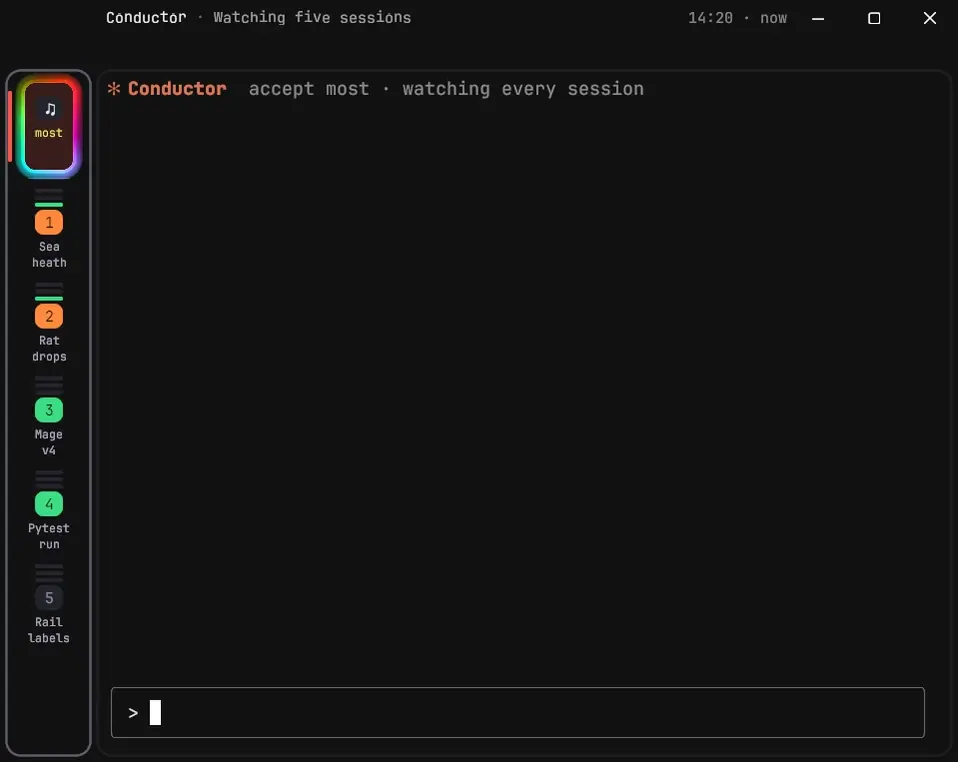

# LBTerm

LBTerm is Lachlan Brown's fork of [WezTerm](https://github.com/wezterm/wezterm), the GPU-accelerated terminal emulator by Wez Furlong. It follows upstream `main` and adds changes for Lachlan's own setup on Windows, where it has been his daily terminal since 2026-10-20.

Most of what it adds is for running many Claude Code sessions at once, a tab each. The pad at the top of its tab rail is the Conductor: one Claude session that reads every other session and answers or directs them, so the agents get recursive feedback through it. LBTerm shows it working: a tab it reads gets an iridescent outline on the rail, and a light runs round a tab it acts on.



*A staged run with made-up sessions: the Conductor reads four tabs at once, says who needs me, then types my answer into one.*

## At a glance

Each of these is described in full under "What's different from WezTerm" below, and in the design doc named after it.

- **A tab rail** down the left, one pad per tab, lit by its Claude Code session's state (working, waiting on you, finished or stuck), with a label a small model writes under it ([TAB-PANEL.md](/lbterm/TAB-PANEL.md))
- **A context bar** down the right: what fills the open conversation's context window, from each file Claude Code loaded to what's still free, widening under the pointer with each part's size and opening a pane of the files, where one can be taken out of the next session's start ([CONTEXT.md](/lbterm/CONTEXT.md), "The context bar")
- **A scroll strip** that maps a whole Claude Code conversation from its transcript. Every prompt, question, error, commit and compaction is a mark you can click to jump to ([SCROLL-STRIP.md](/lbterm/SCROLL-STRIP.md))
- **Question colours**: each question in a reply shares a colour with the passages it's about, and holding the right button brings out a bar of the conversation's questions, each ticked once you've answered it ([QUESTIONS.md](/lbterm/QUESTIONS.md))
- **A cost pane** from the pill's dollars: the open conversation's cost at list price, split into its turns, subagents and workflows, with a graph over time that marks each compaction with the context's size before and after it ([CONTEXT.md](/lbterm/CONTEXT.md), "The cost pane")
- **The Conductor**, one Claude session that reads the others, in a view LBTerm draws itself, with Allow and Deny on anything it wants to do and progress bars a small model guesses and learns from ([TAB-PANEL.md](/lbterm/TAB-PANEL.md), "The Conductor")
- **Tabs that outlive the window**: they live in a separate server process, so a crash, a lost GPU or an update restart leaves them running, and the window comes back exactly where it was ([MUX.md](/lbterm/MUX.md))
- **Crash restore**: after an unclean exit, pick which tabs to reopen, and Claude Code tabs resume their conversation ([RESTORE.md](/lbterm/RESTORE.md))
- **Voice drafts**: a spoken answer waits on a card over the pane it's for and only gets typed when you say send, never into a permission prompt ([CONTROL.md](/lbterm/CONTROL.md), "Drafts")
- **Image thumbnails** inside the terminal, including live charts that redraw when their file changes ([THUMBNAILS.md](/lbterm/THUMBNAILS.md))
- **Panes as rounded cards** that move on springs when they split or close ([DESIGN.md](/lbterm/DESIGN.md), [COMPOSITOR.md](/lbterm/COMPOSITOR.md))
- **Fixes to WezTerm**, among them output that paints at a full 50 frames a second under a 50 fps cap on about 40% less CPU, where it managed about 30 ("Fixed", below)

This file is LBTerm's readme, kept in `.github/` so GitHub shows it in place of upstream's `README.md`, which stays as WezTerm wrote it so upstream merges don't conflict over it. WezTerm's own documentation is at [wezterm.org](https://wezterm.org/), and everything there still applies unless this page says otherwise.

## Licence

WezTerm is MIT-licensed, copyright (c) 2018-Present Wez Furlong. `LICENSE.md` is upstream's and stays unchanged: its notice covers all the WezTerm code in this repository and goes with every copy, including the built executables (their `LegalCopyright` field). The fonts and libraries bundled with WezTerm keep their own licences, listed in `licenses/` and the dependency folders. LBTerm's own changes are MIT-licensed too, copyright (c) 2026 Lachlan Brown (`lbterm/LICENSE.md`).

## This repository

LBTerm is built in a private repository, and this public one is exported from it with `lbterm.ps1 publish`. Its history is WezTerm's, then one commit per export, which lists the changes merged since the one before. Some of what LBTerm adds reads files that other parts of Lachlan's setup write: the summaries and status files of his Terminal project's Claude Code tooling, and the Conductor's state. Each of those is off unless a config turns it on.

## What's different from WezTerm

LBTerm installs and runs beside WezTerm without either finding the other:

- The executables are `lbterm.exe`, `lbterm-gui.exe` and `lbterm-mux-server.exe`.
- The window class and Windows app id are `com.lachlanb.lbterm`. Windows groups LBTerm on its own taskbar button, and a GUI publishes its socket under this id, so `lbterm` never opens a window in a running WezTerm or the other way round.
- Sockets, logs, plugins and caches go in `lbterm` folders: `~\.local\share\lbterm`, `%APPDATA%\lbterm`, `%LOCALAPPDATA%\lbterm`.
- The config is `~\.lbterm.lua` or `~\.config\lbterm\lbterm.lua`. When neither exists, LBTerm falls back to WezTerm's config, so it starts out looking like the WezTerm it came from. Inside that config, `wezterm.app_name` is `"LBTerm"`; in WezTerm it's `nil`.
- It has its own icon, version info and `--version` text, and it doesn't check WezTerm's GitHub releases for updates.

Names that other programs and scripts depend on stay WezTerm's: the `wezterm` Lua module, the `WEZTERM_*` environment variables, `TERM_PROGRAM=WezTerm` and the `wezterm` terminfo entry.

What LBTerm adds, each off unless its config turns it on:

- `lbterm_compositor` and `lbterm_motion`: panes drawn as Windows compositor layers that move on springs when they split or close (`lbterm/COMPOSITOR.md`).
- `lbterm_tab_panel`: a panel of tabs down the left with each Claude Code session's status (a green arc turning on the pad while Claude has handed the turn back but its background tasks still run; orange when its reply asks you something in text and blue ringed in faint orange when all it asks is whether you want extras, from Terminal's hooks, over Claude Code's own "done"; a working pad ringed in amber when its reply has shown nothing for 3 minutes with no tool running, and amber saying "Stuck? 8m" at 7, from Terminal's statusline, over Claude Code's own "working") and, under each pad, a label saying what the tab is for (from Terminal's summary worker through `lbterm_summaries`), the open tab ringed and barred in red, ringed with a grey hairline and lit red while open, that opens on hover and presses the panes' cards over, its ring lighting the moment the pointer reaches it or dimming the moment it leaves, before the edge moves, and turning round when the pointer changes its mind; it takes the tabs out of the tab bar unless `tab_bar = true` (`lbterm/TAB-PANEL.md`). Resting on a row whose session still has subagents, background commands or Monitors going drops a card beside it listing each, how long it's been running, and for a subagent its latest tool call, tool calls and tokens, read from its own transcript only while the card is open (with `lbterm_summaries`, from the list Terminal's statusline keeps there; `lbterm/TAB-PANEL.md`, "What's running"; `lbterm\perf\rail-tasks.ps1`). An experiment, off by default: `wave = { enabled = true }` sends a wave of characters washing out over the panes just ahead of the opening edge, on past where it stops, breaking into spray, without slowing the panel (`lbterm/TAB-PANEL.md`, "The wave"; `lbterm\motion\panel-demo.ps1 -Wave`).
- `lbterm_summon = { key = 'PageUp', mods = '' }`: a key that brings LBTerm forward from any other app, un-minimised if it was, at whatever size and place it had. It's held (RegisterHotKey, on a message-only window) only while no LBTerm window has the keyboard, so inside LBTerm the key reaches the terminal as usual. The last LBTerm window to have the keyboard comes forward (`wezterm-gui/src/summon.rs`, `lbterm-extras/src/summon.rs`).
- `lbterm_summaries = '<folder>'`: where Claude Code sessions' summaries are, as Terminal's summary worker writes them (`<session>.txt`, `.detail.txt`, `.label.txt`, and `expanded.flag` for Alt+S), with `.cwd.txt` from its statusline, the folder the session is in now, which names the tab's project in the tab panel. A pane's session is its `claude_session` user var. Only the sessions LBTerm asks about are read, on a thread of their own that watches the folder, and every window repaints when one changes; nothing is read on the GUI thread (`wezterm-gui/src/summaries.rs`, `lbterm-extras/src/summaries.rs`).
  With the tab panel hiding the tabs, the window strip shows the active tab's title, its session's summary and when it was written ("22:22 · 2m ago"). Resting the pointer on them drops the detail down in a card under the strip, and Alt+S's flag pins it open (`lbterm/DESIGN.md`, "The window strip"; `wezterm-gui/src/termwindow/render/strip.rs`, `lbterm-extras/src/strip.rs`; `lbterm\perf\strip-summary.ps1` checks it end to end). Terminal's summary pane doesn't open in LBTerm while its `lbterm.lua` sets this.
- `lbterm_prompt_history = '<Claude Code's history.jsonl>'`: with the tab panel hiding the tabs, the window strip gets a second row with the Claude pane's last prompt (claudehook.exe's `claude_prompt` user var). A click on it jumps the conversation back to it, by pressing Ctrl+End and then PgUp in Claude Code until the message is on screen, and an arrow before it lists every prompt the session sent, newest first, each a jump. Resting the pointer on a prompt cut short shows all of it (`lbterm/DESIGN.md`, "The window strip"; `wezterm-gui/src/termwindow/render/prompt.rs`, `lbterm-extras/src/prompts.rs`; `lbterm\perf\strip-prompt.ps1` checks it end to end against `perf\fake-claude.ps1`, a stand-in for Claude Code's fullscreen view).

- Question colours, with `lbterm_summaries` and the `LbtermQuestions` action bound to a held right button: each question in Claude's reply and every passage of the reply it's about are coloured alike, Q1 blue, Q2 green and on, the options with their question, and a chip at the conversation's edge points to any part scrolled out of view. Terminal's question worker has Haiku find them after each reply that asks something (`lbterm/QUESTIONS.md`; `wezterm-gui/src/termwindow/render/questions.rs`, `lbterm-extras/src/questions.rs`; `lbterm\perf\questions.ps1` checks it end to end against `perf\fake-reply.ps1`).

- `lbterm_inbox`: an InMail button on the window strip, over the tab rail, saying how many messages wait in a set of folders (one Markdown file each, as Lachlan's projects send each other), the real count however many, in the rail's waiting orange. A click lists them, newest first, a repo's message with the projects card's blue repo mark; picking one fires the `lbterm-inbox-open` Lua event with the message, and unless a handler returns false, opens a new tab in its project's folder. Lachlan's config opens Claude Code there, told to read it. The folders are read off the GUI thread every second, only new and changed files opened; a message arriving or archived dissolves the count into the new one. A link in a pane to one message (`lbterm://inmail/<project>?message=<file>`) is drawn in the waiting orange while the message waits, and grey, struck through, once it's been dealt with; a link to a project none of the folders is the InMail of is drawn as any link (`lbterm/INBOX.md`; `wezterm-gui/src/termwindow/render/inbox.rs`, `wezterm-gui/src/inbox.rs`, `lbterm-extras/src/inbox.rs`; `lbterm\perf\inbox.ps1` and `inbox-links.ps1` check it end to end).
- `lbterm_context`: a pill on the window strip's second row, under the InMail button, saying what the open tab's Claude Code conversation has cost at list price, every run of it and its subagents (from a file another program writes beside the session's summary; Claude Code's own `/cost` starts again at $0 on a resume). A press on it opens the cost pane (below); the list of the files in the conversation's context it dropped until the context bar came is the bar's pane now. The open tab panel's rows end with each tab's cost. A change to a cost repaints only a window that shows it (`lbterm/CONTEXT.md`; `wezterm-gui/src/termwindow/render/context.rs`, `lbterm-extras/src/context.rs`; `lbterm\perf\context.ps1` checks it end to end).
- A context bar down the window's right, in place of the objectives strip (`lbterm_context_bar`, `lbterm/CONTEXT.md`, "The context bar"): the open tab's Claude Code conversation's whole context window, top to bottom, each file loaded into it a section of its own (memory files yellow, CLAUDE.md files grey, another project's pulled in amber), then Claude Code's own system prompt, tools and skills list, then the conversation, and free space below, so how far down it's filled says how full the context is, to the pixel. A small file keeps 3 px; what's in use is the last reply's own count, the files' sizes scaled by the conversation's first request. Resting on it widens the bar itself over the terminal to the closed rail's width, each section with a line's room and its tokens written on it, a pane as wide as the bar coming out from under its moving edge as it widens, in the one slide, for the numbers of sections too thin for theirs, and resting on a section slides a pane out beside it, its totals pinned at its foot under a rule while the files scroll when they don't all fit, listing every section with its path, kind, tokens and Remove button, the wheel scrolling its rows when they don't all fit, the scroll strip riding on its edge; going back, the pane of thin numbers slides in with the scroll strip gliding home beside it under the widened bar, which then narrows past it, all started at once, as it came out; the terminal keeps its size throughout. A memory file's Remove takes its line off its MEMORY.md and an import's takes just its `@` off in the CLAUDE.md importing it, on whatever line it's on, the line's words and the path staying as plain text, never deleting a file or a line, every other line and its line endings as they were, with an Undo that puts the line or the `@` back where it was while the tab's pane is open, past a compaction too (the removed file listed in the pane with its Undo once its section has gone); Compact now types `/compact` into the tab, only while Claude Code is at its prompt with nothing typed and not working (the tab's light, which Terminal's hooks set while Claude works and while it compacts), says why it can't otherwise, and stays dim in every window from the press until Claude Code has compacted. Compact now writes nothing but `/compact`: a compaction loads the memory index and the CLAUDE.md files again without what was removed, but Claude Code attaches a removed file itself again after the summary while it's among the five files it restores, and the only thing that stops that is a rule in settings every Claude session reads, which Compact now no longer writes. So a removed file's row says a compaction can attach it again, and one attached again is a section of its own, `attached`, hatched, its row saying so with its Undo. With the bar, the files the cost pill under the InMail button listed are the pane's rows (a press on the pill opens the cost pane, below), and the projects pad that was on the objectives strip sits beside it on the strip's second row, working whether the objectives strip is on or not.
- A press on the context pill opens a cost pane under the tab strip, as wide as the panes: what the tab's Claude conversation has cost at list price, split into his turns, subagents and workflows with the input, cache writes, cache reads and output under each, the compactions (whose cost Claude Code doesn't record), and a graph of the cost over time marked where each subagent and workflow started and where each compaction was, with the context's size before and after it; counted off the GUI thread as Terminal's statusline counts the pill's dollars, so the two agree. That count is LBTerm's own and is off unless asked for (`lbterm_context.count_cost`, for someone without the count the pill's dollars come from): off, nothing of it runs, no transcript read and nothing counted, and the pane shows the same split as the Claude project publishes it (`<session>.cost.json` beside the pill's `usage.json`, read again only once the Claude project has written it again: an opening on a split not written since reads nothing and draws only the press's frame, and an open pane follows each write), or the pill's dollars and the context window and why while there's none to show. The projects pad beside the pill keeps its place in a tab without a Claude session.
- `lbterm_let_go`: a folder of requests, each a JSON file naming a folder and until when, that has every folder LBTerm watches inside the named one step up out of it, so another program can rename or remove it: Windows refuses either while a handle inside is open, and the InMail button's watches sit inside every project (`lbterm/LET-GO.md`; `wezterm-gui/src/let_go.rs`, `lbterm-extras/src/let_go.rs`, `lbterm-extras/src/watch.rs`; `lbterm\perf\let-go.ps1` checks it end to end).
- `lbterm_agenda`: a button on the window strip after the InMail button, with the counts of what's urgent (in the waiting orange) and what's failing (in red) from a file another program keeps, which drops a list of what's to do, coming up and failing: what's urgent first, then what's failing (both headed with the button's numbers, the file's own), what's coming up and the to-dos that are yours, a group's rows folded into one line until it's opened, and the agents' to-dos behind a line that shows them. A click opens a row, its detail and its buttons under it: its own, Claude, a snooze and its page, each handed to Lua (`lbterm-agenda-press`) to run; one that asks first says so before it goes. The file is watched, never polled (`lbterm/AGENDA.md`).
- Thumbnails: a link to `lbterm://image/<path>` is an image's caption, and rows under it of links to the same image with `?row=<r>&of=<n>`, their words blank cells, get the image drawn small into the cells they cover, with a hairline round it that brightens under the pointer. Each row says where it sits, so a picture half scrolled out of a fullscreen program's view shows the half in it; a click opens the link through `open-uri`, even while the program has the mouse. Decoded off the GUI thread at the size drawn, within limits on file size, sides and memory; a file that's deleted shows as a grey box with its caption struck through, and comes back with the file. An SVG is drawn at its box's size, its text in the system's fonts, and reads nothing it names. A file that's rewritten is drawn again in the same place in the atlas, so a program that keeps rewriting a chart gets a live chart in the conversation without filling the atlas (`lbterm/THUMBNAILS.md`; `wezterm-gui/src/termwindow/render/thumbnails.rs`, `wezterm-gui/src/thumbnails.rs`, `lbterm-extras/src/thumbnails.rs`; `lbterm\perf\thumbnails.ps1` checks it end to end).
- `lbterm_conductor`: the Conductor (a Claude Code session of Lachlan's that directs the others) on the tab rail. Its pad is the rail's top slot: its mode under it (read green, most yellow, all red), a grey outline while it only reads (the spectrum while the pointer's on it), and while it may act on its own a still outline in the mode's colour, lit with every hue running round it while it acts on a session or the pointer's on it. The pad is the Conductor's tab: the tab holding its session (the state file's `sessionId`) has no row of its own, stays first in the window, and opens with a left click on the pad, which then has the open tab's ring and bar. A right click drops its menu, the items its state offers and the mode it's in ticked, each any action, `wezterm.action_callback` included; while it's off a left click does too. While it thinks about a tab's Claude session, that tab's pad gets a pale iridescent outline; while it acts on one, a light goes round it too. Its state comes from its state file (read off the GUI thread when it changes), what it's on from its hub over a named pipe, and LBTerm tells the hub which tab and pane holds each session (`lbterm/TAB-PANEL.md`, "The Conductor"; `wezterm-gui/src/termwindow/render/conductor.rs`, `conductor_hub.rs`, `state_files.rs`, `lbterm-extras/src/conductor.rs`; `lbterm\perf\conductor.ps1` checks it end to end).
- The Conductor's view (`lbterm_conductor.seat_pipe`): the Conductor runs in the background in a process of its own, the seat, which serves its interfaces on a named pipe, and LBTerm draws its view itself in the window's tab area, opened by a left click on its pad, in Material's dark look with Roboto. Its conversation (each day under its name and every message with its time, the replies streaming in with light markdown and links that open a session's tab, tool calls as quiet rows, the hub's wakes as cards, a session needing you as an alert) and a box to type to it, the header with its state and controls (on and off, its three modes, listening), and down the side, which folds to a navigation rail as wide as the tab rail, what it asks to do with Allow and Deny, the questions sessions wait on with their options as buttons, every session with its guessed bar, the hub's events, suggestions to send, dismiss or rate, and its notes. While it asks something the pad is orange. The tab under it stays open; a click on any tab's row, or Esc, leaves it (`lbterm/TAB-PANEL.md`, "The Conductor's view"; `wezterm-gui/src/termwindow/render/conductor_view.rs`, `seat_client.rs`, `lbterm-extras/src/seat/`; `lbterm\perf\conductor-view.ps1` checks it against a seat it plays).

- `lbterm_objectives`: an objectives panel down the right of the window, for keeping track of what each Claude Code session was started for. A narrow strip has a mark level with each tab's pad on the tab rail: a green dot when everything the session was asked for is done, a green ring when what it was started for is done and something asked later isn't, a yellow ring when it went off on something else with its first ask still open, orange when that waits on you, grey while it's on it. Resting the pointer on the strip opens a card of each tab's first objective with how many are done; resting on a row opens that session's whole list, each objective's status and what showed it; a click opens the tab. The objectives come from `<session>.objectives.json` beside its summary, which the same model call that writes the summary keeps (`lbterm/OBJECTIVES.md`). Needs the tab panel and `lbterm_summaries`.
- `lbterm_links = { file = '<links file>' }`: tab links, one Claude session waiting on another's work. A right-button drag of a tab's row onto another's makes the first wait on the second: a line joins their pads down the rail's left edge, the waiting pad turns purple (ringed orange while it asks you something too) and says what it waits for, and it goes red when the link goes wrong. While it drags, a card says what the dragged session waits for and another lists the objectives of the tab under the pointer, the two matching blocks lit green with a light running round them. Resting on a line opens a card saying who waits on whom, where it stands and for what, and the tab menu can mark what a tab waits for complete, which tells it to carry on at once. The links live in a file a program of the config's keeps, which tells the waiting session when to carry on; each thing done to one fires the `lbterm-tab-link` Lua event (`lbterm/LINKS.md`).
- `lbterm_projects`: a pad on the window strip's second row, right of the context pill under the InMail button (in its place without it), that opens a card of every project under the strip, the busiest first: its Claude sessions in every window (working, waiting on you, idle) with their subagents and background tasks, and the InMail waiting for it. A repo that's part of a project (its `parent`) is listed under that project, indented past a blue repo mark. On a row, buttons start a session there, one told to read its InMail, or resume its last, through the `lbterm-project-action` Lua event (`lbterm/OBJECTIVES.md`, "The projects card"). It needs no objectives strip: it was at the top of that strip until the context bar took its room, and its rest and grace are `lbterm_projects`' own.
- `lbterm_scroll_strip`: a strip left of the objectives panel, looking like it, that's the open tab's scrollbar, the panes' own scrollbar going. In Claude Code's fullscreen view, which keeps its conversation to itself, it's the conversation's, read from the session's transcript as it grows: each message, edit diff, new file's first rows, thinking and task line takes the rows Claude Code draws it in at the pane's width (a 5,800-row session laid out within 5 rows), a coral bar marks each prompt you sent, dots and ticks mark where Claude asked you something, showed a permission prompt, was turned down, hit an error, started a subagent or background task, committed, edited a file, sent InMail or filed work for later, finished a turn or was interrupted, and a line marks each compaction, the part above it dimmed. The thumb is where the screen says Claude Code is scrolled to. It stands beside the conversation's rows only, not the input box and status under them. A click on a mark or the track, or a drag of the thumb, scrolls Claude Code there with its own keys, written a burst at a time (a click lands within about a second, even on a long session), and marks the row it lands on; any key or wheel turn of yours stops it, and a dialog in the input box's place says so. Resting on a mark opens a card with its words and time. At a shell it's the scrollback's, with a bar at each prompt (`lbterm/SCROLL-STRIP.md`; `wezterm-gui/src/termwindow/render/scroll_strip.rs`, `wezterm-gui/src/conversations.rs`, `lbterm-extras/src/conversation.rs`). Needs the tab panel.

On unless the config turns it off:

- `lbterm_crash_restore`: after LBTerm ends without closing cleanly, its next start asks which of the old tabs to open again, all or some, each in its folder, Claude Code tabs resuming their conversation (`lbterm/RESTORE.md`).
- `lbterm_hide_scroll_bar_in_apps`: the scrollbar hides while the active pane's program has the whole screen (the alternate screen or mouse reporting on, as Claude Code's fullscreen mode has), since that program scrolls its own view and the thumb can't follow it; it's back at a shell. On mux panes the server sends both modes with each change. The scrollbar's room stays, so nothing resizes (`lbterm/DESIGN.md`, "The scrollbar"; `lbterm-extras/src/scrollbar.rs`; `lbterm\perf\scrollbar-apps.ps1` checks it end to end).

- `lbterm_triggers`: patterns that watch the text panes show, colour what they match, play an effect and fire the `lbterm-trigger` Lua event, after iTerm2's triggers. Without the key, two easter eggs: "love" goes a little pink and sends hearts up from the pane's corner, and "LB" goes rainbow (`lbterm/TRIGGERS.md`).
- `lbterm_hex_colours`: a `#RRGGBB` colour code in a pane's text (`#FFBF00,`, `(#8a8a9e)`, `color: #F2E86D;`, not `abc#FFBF00`, `#FFBF00AA` or `#fff`) gets a bar in its own colour along the foot of its cells, about 2 px, outlined in the text's colour when the colour is too near the background to see. Every character stays as it is, so copying and links are unchanged; a code the program underlined keeps its own line, one it hid stays hidden, and one it already shows on a background of its own colour gets no bar. Found as a row is laid out and kept with its drawing, so it costs nothing on a still screen or a scroll (`lbterm/HEX.md`; `lbterm\perf\hex-swatch.ps1` checks it end to end).

Always on, because it's a protocol or a fix to how WezTerm already looks (prompt marks), or it's LBTerm's look:

- The shape of LBTerm's design system (`lbterm/DESIGN.md`): every pane a card, the surface colour with 12 px corners, a 4 px gutter between panes and in from the window's edges in place of split lines (still where a drag resizes them). The pane with the keyboard has a hairline round it, which glides to the next pane when the keyboard moves, and the others' text sits at 85%, dimming and brightening as it goes. With the compositor a card stays whole and rounded as panes move. The scrollbar sits inside the card on the right, its track down the active pane (`wezterm-gui/src/termwindow/render/card.rs`, `lbterm-panel/src/shape.rs`). Its first principle: every action answers at once, in the next frame, and a delay holds back only what it guards, never the answer (`lbterm/FEEDBACK.md` lists every action, what answers it, and the gaps still open).
- Every action answers on screen (`lbterm/DESIGN.md`, principle 1; with the compositor and motion on). The active pane's outline goes out while the window hasn't the keyboard and pulses back as the keyboard arrives from outside it: the summon key, a toast's click, Alt+Tab, a pane activated by the Claude project or the Conductor (`lbterm_extras::arrival`). A right-click in a pane sends a ripple from where it landed; what's copied (a drag let go, Ctrl+Shift+C, a quick-select pick) and a link being opened light up and fade; resizing the window or changing the font shows the active pane's size in cells in the middle of it for a moment; a scrollbar mark's click and a search's next match mark the row they land on (`wezterm-gui/src/termwindow/render/lights.rs`, `lbterm-extras/src/lights.rs`; `lbterm\perf\pane-feedback.ps1` checks them end to end). On the window strip, words that change in a tab dissolve into the new ones and a new summary or prompt brightens once; a notice takes the caption's place for a moment ("Config reloaded", "Restarting…", "Updated to <version> · 12 tabs back", "Reattached 12 tabs" after a crash); a tab on its way says so there until it comes ("Opening Chronos's InMail…", from the config's `window:lbterm_expect_tab`, past a quarter second); and a zoomed tab wears a badge, "Zoomed · 2 of 3" (`wezterm-gui/src/termwindow/render/strip_swap.rs`, `lbterm-extras/src/strip.rs`; `lbterm\perf\strip-feedback.ps1`). On the tab rail, the open tab's ring and bar glide to the new tab; a new tab grows in and a closed one fades where it was as the rows below slide up; a row whose state, words, label or colour changes dissolves into its new look; progress glides along its bar; a pad glints when a program types into its tab through `lbterm cli` (the Conductor, Relay, the Claude project) or the tab is renamed; a dragged row is lifted and follows the pointer, and dragged out past the window a card with its name follows it while another LBTerm window under it shows where it would land (`PanelLayers` in `compositor.rs`, `wezterm-gui/src/tab_ghost.rs`, `mux/src/lbterm_typed.rs`; `lbterm\perf\rail-feedback.ps1`).

- Progress on the taskbar button: what programs report with ConEmu's OSC 9;4 (winget, PowerShell's `Write-Progress`) shows on LBTerm's taskbar button as Windows Terminal's does, green, red, sweeping or paused-yellow. The active pane's progress shows; when it reports none, the first pane in tab order that does. Needs the WebGpu front end, which keeps the window's HWND (`wezterm-gui/src/termwindow/taskbar.rs`, `lbterm-extras/src/taskbar.rs`; `lbterm\perf\taskbar-progress.ps1` checks it end to end).
- Prompt marks on the scrollbar, as Windows Terminal draws them: a coral tick for every shell prompt a shell marks with OSC 133 (Terminal's pwsh profile does), where it sits in the whole scrollback. A click on one scrolls that prompt to the top; anywhere else on the track pages as before. Only the rows written since the last look are read, so a 50,000-line scrollback is read once, a chunk at a time between frames, and for a tab in the mux server the server says which rows hold a prompt (`wezterm-gui/src/termwindow/render/marks.rs`, `lbterm-extras/src/marks.rs`; `lbterm\perf\scrollbar-marks.ps1 -ClickMark 10` shows it). Needs `enable_scroll_bar`.
- OSC 99, kitty's desktop notifications, as Windows toasts: title and body, buttons, a click that brings the pane forward and can tell the program, updates and closes by id, shown always, only when unfocused or only when the pane can't be seen. Claude Code's `kitty` notification channel speaks it (`lbterm/NOTIFICATIONS.md`).
- OSC 7501, the Program Status Protocol: a program such as Claude Code reports working, blocked (and why), done or failed, with a title, a message and progress, for itself and its subagents. The tab panel shows it, and Lua reads it with `pane:get_program_status()` (`lbterm/TAB-PANEL.md`).
- How far along each Claude session is, guessed: the Conductor's hub has a small model guess how far through its task each session, each of its subagents and each command it left running in the background is (a build or a test run, from the end of its output), every couple of minutes, and learns from how wrong its guesses turn out. LBTerm draws the guess on the tab's bar where the program reports no progress of its own, dimmer than real progress, with each subagent's and background command's bar beside it and the time left in the open row ("~4 min left"); the open tab's guess goes on the taskbar button when nothing reports progress (`conductor.estimates` on the hub's pipe, `lbterm/TAB-PANEL.md`; `lbterm\perf\estimates.ps1` checks it end to end).
- Tabs with the mouse: drag a tab along the tab panel (or the tab bar) to move it, out of the window to give it a window of its own where it's let go, or onto another LBTerm window to move it there. A right-click on a tab opens a menu in the panel's style in place of the tab navigator: rename in place, a colour (a ring round the tab's pad), duplicate, move to a new window, close the others, close; neither asks first: picking it is the answer. A close that still asks (Ctrl+Shift+W) shows its question once the panel has folded, so its Yes doesn't slide out from under the pointer. With the Conductor's pad on the rail, the last tab going doesn't close LBTerm, whether it's closed or its program ends (`exit`, `kill-pane`): a new tab takes its place first, with the Conductor's view over it (`lbterm/TAB-MOUSE.md`; `lbterm\perf\last-tab.ps1 [-Mux]` checks it).
- Held modifiers show: while Ctrl, Shift or Alt is held the active pane's outline goes to full light in its colour, Ctrl blue, Shift green, Alt red, added as light when several are (Ctrl+Shift cyan), so a modifier that didn't register can be seen before the key it was meant for (`wezterm-gui/src/termwindow/held.rs`; `lbterm\perf\modifier-light.ps1`).

- Tabs that outlive the GUI: with a unix domain in the config and `default_gui_startup_args = { 'connect', 'unix' }`, the tabs live in `lbterm-mux-server`, so a crash, a lost GPU or a restart after an install leaves them running and the next LBTerm attaches to them, user vars, progress and OSC 7501 included. Closing a window or quitting still ends its tabs, where WezTerm would detach, and the server ends with its last tab (`lbterm/MUX.md`).
- Restart to update: `lbterm.ps1 install` writes the build's version beside the exes, and while it names another build than the running one, a "↻ Restart to update" pill shows on the window strip, left of the buttons. A click on it, or Ctrl+Shift+F5 (`LbtermRestart`, also in the command palette), starts the installed GUI with the same arguments and ends this one as a crash would, so the tabs live on in the mux server and the new GUI attaches to them. It refuses when a pane in one of its tabs runs in the window itself rather than in the server, and says so in the strip and a toast; an overlay such as the launcher or a confirm prompt, a pane of the GUI's own, doesn't count (`wezterm-gui/src/restart.rs`, `lbterm-extras/src/restart.rs`; `lbterm\perf\restart.ps1` checks it end to end).
- Windows open where they were: each window's place (its normal rectangle and whether it's maximised) is kept as it moves, is resized, maximised or snapped, by the id its mux server knows it by, and a new window opens on that screen and is shown at that place before anything is drawn, so a restart, `lbterm.ps1 restart` or a crash brings it back exactly as it was and no tab is resized. Before, the new window came up where Windows puts new ones: on a screen too small for it, it was cut down and every tab's program redrew at the new size, then again when it was put back. A restart's replayed `--position` gives way to the saved place. Only Lachlan's own LBTerm keeps places (`~\.local\share\lbterm\placement`); try and test windows don't unless `LBTERM_PLACEMENT_DIR` names a folder (`lbterm-extras/src/placement.rs`, `wezterm-gui/src/placement.rs`, `window/src/os/windows/window.rs`; `lbterm\perf\restart.ps1`).
- `lbterm cli spawn --no-activate`: adds the tab without switching the window to it, so nothing typed lands in a tab an agent opened (Conductor's sessions). On the mux domain the GUI never followed a spawn's switch, but the server did, and told the tab it switched from that it had lost focus; with the flag it doesn't. A mux server of an older build doesn't know the flag (`SpawnNoActivate`, PDU 7502), and the spawn fails saying so, opening nothing (`lbterm\perf\spawn-no-activate.ps1` checks it).
- `lbterm cli spawn --pane-id <id>` with a pane the server doesn't have fails, naming the pane, where WezTerm opens a new window without a word. A caller that asked which pane was focused could be told about one that had just closed, and its tab came up alone in a window of its own. `--new-window`, `--window-id`, and no `--pane-id` (`WEZTERM_PANE` or the server's choice) work as before (`wezterm/src/cli/spawn_command.rs`).
- `lbterm cli spawn` into a window the server has runs no config. WezTerm's cli runs the whole config file for every spawn, to read a workspace name and a first window size, which the server ignores for a tab in a window it already has; Lachlan's config took about half a second to run. It's run now only for a spawn that opens a window (`wezterm/src/cli/spawn_command.rs`).
- A control pipe, for other programs on the PC to ask the window things a `cli` against the mux server can't: which pane he's looking at (the window he was last in, its open pane by the server's id, the Claude session in it, whether LBTerm has the keyboard), and running one of the config's Lua events there as a key would, so a voice listener's "next tab" is the same hop as the mouse's side button. One JSON line each way on `\\.\pipe\lbterm-control-<window class>`, so a try or test window never answers for the daily one, and `lbterm control focus` or `lbterm control emit <event>` from a shell (`lbterm/CONTROL.md`; `wezterm-gui/src/control.rs`, `lbterm-extras/src/control.rs`, `wezterm/src/control.rs`; `lbterm\perf\control.ps1 [-Mux]` checks it end to end).
- Voice drafts, for answering a Claude session by voice: an answer the listener heard is held over the pane it's for, on a card just above Claude Code's input box, each answer barred in its question's colour, while the pane's question colours show with a tick on each question it answers and a red ring round the next it doesn't (round its marker at the edge when it's scrolled off; `lbterm_next_question_extras = false` leaves extras out). "Send" types it whole, each new line as Shift+Enter and then Enter, only into Claude Code's prompt, and never into a permission prompt or a menu; "edit" types it in without sending; "scratch that" takes the newest piece back. A draft belongs to its pane and its Claude session, so a tab switch can't send it anywhere else (`draft.*` on the control pipe, `lbterm control draft`, the `LbtermDraft` action; `lbterm-extras/src/drafts.rs`, `wezterm-gui/src/termwindow/render/draft.rs`; `lbterm\perf\draft.ps1` checks it against a stand-in Claude Code that writes down every key it's sent).
- A mic on the window strip while the voice listener listens: dim, red while it hears speech, struck through while it's paused, gone once the listener stops saying so; what it heard shows as the strip's notice (`mic` on the control pipe; `lbterm-extras/src/mic.rs`, `wezterm-gui/src/mic.rs`; `lbterm\perf\mic.ps1`).
- The slow-frame log: whatever holds the GUI thread longer than `lbterm_slow_ms` (33 by default, two refreshes of a 60 Hz screen; 0 turns it off) is named in the GUI's log, a WARN under `lbterm::slow`, since that thread also takes every keypress: a window message (`WM_KEYDOWN`), a task by where it was spawned (`wezterm-gui/src/termwindow/mod.rs:1754`) or a part of a window's paint (`window-0/pass`, `/draw`, `/present`), each stall charged to the innermost of them. A thing's first time over in 10 s is logged at once, and one line sums up the rest as those 10 s end (`lbterm-extras/src/slow.rs`; `lbterm\perf\slow.ps1` checks it end to end, and `-Measure` shows what ordinary use holds the thread for).
- `wezterm.gui.clipboard_has_image()` in Lua: whether the clipboard holds a bitmap, asked of Windows at once, without opening the clipboard. Terminal's `lbterm.lua` uses it for Shift+right-click's smart paste, which sends Claude Code Alt+V for an image and pastes text otherwise; WezTerm, without it, starts Windows PowerShell to look, 250 to 310 ms a paste (`wezterm-gui/src/scripting/mod.rs`; `lbterm\perf\clipboard-image.ps1` checks it against `Get-Clipboard -Format Image`).
- The mouse's side buttons in `mouse_bindings`, as `button = 'Back'` and `'Forward'` (WezTerm leaves them to Windows, so they do nothing). Their bindings run wherever the pointer is, over the panes, the tab panel or the strip, and they never reach the pane's program, even one that has the mouse. `wezterm.has_mouse_button('Back')` says whether a build knows them, so a config shared with an older build, or the mux server it started, binds them only where they work. Terminal's `lbterm.lua` binds them to the previous and next tab.

Fixed:

- A click on a link in a program that has the mouse opens it. Claude Code takes every click while it runs, and does nothing with one on a link, so the pointer's hand over a link promised what the click didn't do. A plain left press and release on the same link are LBTerm's now, and the program sees none of that click; anywhere else it gets the mouse as before. And a click on a link that wobbled across half a cell opens it rather than copying the one character it selected (`wezterm-gui/src/termwindow/mouseevent.rs`; `lbterm\perf\pane-feedback.ps1` checks both sides).
- LBTerm's own links (`lbterm://`) never go to Windows. One that no `open-uri` handler took, or an `OpenUri` action given one, went to Windows, which has no app for the scheme and put up its "get an app for this link" dialog in front of whatever was being typed in. Now it opens nothing and says so in the log (`lbterm-extras/src/own_links.rs`).
- Centred content (`window_content_alignment = 'Center'`) no longer slides right by half the window's border: with the tab panel's strip counted as border, the last few columns were off the window.
- Centred content no longer runs under the scrollbar. Centring counted the right padding without the room the scrollbar keeps inside the card, so the text sat 4 px too far right and the thumb hid the end of every row (`lbterm\perf\scrollbar-clear.ps1` checks it).
- On the mux domain, a split followed by activating the pane it came from keeps the keyboard there. The server made the new pane active without telling the GUI, so the GUI thought the old pane still had focus on the server, never sent the activation, and its next resync handed the keyboard to the new pane. Terminal's summary pane is opened this way, and typing landed in it (`wezterm-client/src/domain.rs`; `lbterm\perf\split-focus.ps1` checks it).
- What `lbterm cli` changes in a window shows there at once. Moving the keyboard to another pane (`activate-pane`, and on the mux domain `activate-pane-direction`), zooming and unzooming (`zoom-pane`) and moving a split (`adjust-pane-size`) changed the mux and left the window on its old frame, outline and badge included, until something else painted it: a program's output, the pointer, a blinking cursor (Lachlan's doesn't blink). The GUI painted for a pane's output, a tab switch and a change to the tab bar's words, and these were none of those, with the keyboard or without, on the mux domain or off it. The Conductor, the Claude project and Relay drive LBTerm this way, often while it's in the background (`mux/src/lbterm_repaint.rs`; `lbterm\perf\cli-repaint.ps1 [-Mux]` checks it).
- A build made in a git worktree says the commit it was built at. The version's build script watched the branch's ref under the worktree's own git folder, where a worktree has none, so its builds kept the commit of their first build, and install could take a new build for the one it replaced (`wezterm-version/build.rs`; the check fails when `lbterm --version` doesn't name HEAD).
- A program that dies with mouse or focus reporting on no longer leaves its shell typing escape codes. A Claude Code killed mid-session left them on, and every mouse move, wheel turn and focus change landed on pwsh's prompt as `[555;25;11M` and `[I`. A shell's prompt mark (OSC 133 A or N, which Terminal's pwsh profile prints) now turns both off, since shells ask for neither; a program still running keeps them (`TerminalState::release_mouse_and_focus`; `lbterm\perf\prompt-mouse.ps1` checks it).
- Closing the open tab fades into the next one instead of cutting to it: the closed tab's panes keep their last frame over the next tab's and fade out (`tab_switch`, 200 ms), the strip's words dissolve into the next tab's, and on the rail the next tab's row comes into its open look. Every rail row whose look gained something (the open fill, a hover) took it at once: the rows' surfaces are clear where nothing's drawn, so the old look fading over the new hid only what went. Now the new look comes in under the old, which goes once the new is three quarters in, and a dissolving row slides with its old look (`lbterm_motion::dissolve`, `RowVisual` in `compositor.rs`; `lbterm\perf\rail-feedback.ps1` checks both).
- An `lbterm cli` call no longer has every pane's changes pushed to it. The mux server sent each connection every pane's new lines and alerts as they came, so for each cli call (the Conductor, Relay, the hooks) it worked out a busy pane's whole screen on its main thread and sent it to a call that drops it. Now only a window, which says who it is as it attaches, and a connection that asked about the pane get them (`mux/src/lbterm_typed.rs`, `wezterm-mux-server-impl/src/dispatch.rs`).
- Starting the mux server runs the config once. The copy started with `--daemonize` ran the whole config only to learn where the server's output goes, then started the server, which ran it again; now it starts the server straight away, and the server sends its own output where `daemon_options` say once its config has loaded (what it logs before then is in its own log file, like everything it logs; `wezterm-mux-server/src/main.rs`).
- Lua's `spawn_tab`, `spawn_window` and `pane:split` start a command in the folder they're given. With `args` and `cwd` both set the folder went to the command alone, and the mux started a spawn without a folder of its own in the open pane's, over the command's (`lua-api-crates/mux/src/lib.rs`).
- An InMail message arriving or being archived, or an image's file going, no longer shapes every line of text in every window again. A link to a message is drawn by whether it still waits, and an image's caption by whether its file is there, so each change started every line's shaping over; now only the lines holding such a link are shaped again (`lbterm-extras/src/link_looks.rs`, `wezterm-gui/src/termwindow/render/mod.rs`).
- A second mux server can no longer cut LBTerm's tabs off. A server took its socket by removing whatever was at its path, so one started on a live server's path (a test's, whose config failed to load, on 2026-10-29) took it, and once it ended nothing new could reach the tabs until the server restarted. Now a server won't bind a path another server answers on, a server whose socket is taken or removed binds it again within seconds (`wezterm-mux-server-impl/src/local.rs`), and a server given a config file that fails to load stops instead of starting on the default one (`wezterm-mux-server/src/main.rs`).
- The Conductor's view no longer keeps the GUI busy while it's open. It laid its whole conversation out again and placed every word on every frame, and the panes under it, which it covers, still repainted the window whenever they printed: with a spinner going in the tab under it, as a working Claude session has, a test window painted 16 frames a second and took 39 to 50% of a core (31 to 42% with the view closed). Now the panes under it don't repaint the window while it's open, and the view is laid out again only when something it shows changes, its clock waking it once when an age it shows would read otherwise ("just now" to "1 min ago"): the same spinner under it paints nothing, at 0.3 to 1.1% of a core. Over a real conversation a frame painted for something else (the rail) takes 6 to 7 ms to build instead of 25 to 32, and a key typed in its box 12 to 14 ms instead of 26 to 30: wrapping measured a line's words again for each word put on it, about 340,000 characters a layout, and the side's words are now wrapped once (`wezterm-gui/src/termwindow/render/conductor_view.rs`, `lbterm-extras/src/seat/layout.rs`, `lbterm-extras/src/seat/text.rs`).
- A frame draws only the parts of the window that changed. With the compositor every visual is a swapchain (24 in a window with four panes and the tab rail), and every frame drew and presented all of them, whatever changed: about 10 ms of a 20 ms frame. Each quad is now folded into a number as it's written, and a visual whose swapchain already shows what the frame would draw into it is left alone while DWM goes on showing it: the InMail button's count changing draws 2 or 3 visuals, and a key typed into one of four panes draws that pane alone (`wezterm-gui/src/termwindow/render/composited.rs`, `lbterm-motion/src/content.rs`; the state file says how many each frame drew and kept).
- An InMail message arriving or being archived costs one frame. An arrival cost three: the button's brightening asked for a frame of its own although it played in the one being painted (so did a pad's glint), the dissolve made its swapchain again for nearly every change, waiting for the GPU each time, and in a window whose panes are its own each frame after a quiet second walked every process on the PC once a pane to name the panes' programs; a pane that hasn't printed for a couple of seconds now keeps the processes it had. In a test window with four panes a change went from 125 to 440 ms of the GUI's CPU to 24 to 46 ms, and on a mux domain from 45 to 110 ms to 24 to 37 (`lbterm/perf/inbox-cost.ps1`; `mux/src/localpane.rs`).
- A tab's pad on the rail follows claudehook's light at once, in a tab in the background and beside the Conductor's view. The light came with nothing to repaint the window for it: a background tab's pad waited for something else to paint, and once the panes under the Conductor's view stopped repainting the window, the tab under the view said "Your turn" for a question claudehook had lit orange (`wezterm-gui/src/termwindow/mod.rs`; `lbterm\perf\conductor-view.ps1` checks both).
- Beside the Conductor's view, a notice under its box that came while another's end was due goes when it's due, instead of staying until something else paints, and the scroll strip isn't drawn: it's the scrollbar of the pane the view covers, and a click on it would have scrolled that pane unseen (`render/conductor_view.rs`, `render/scroll_strip.rs`).
- An InMail message shows on the button at once. The thread looked in the folders every second, so a message showed up to a second after it was written (a median of 293 to 505 ms in a test window) and the thread woke every second for nothing; it now watches the folders and sleeps until one changes, and the button shows a message 46 to 89 ms after its file is written (`wezterm-gui/src/inbox.rs`, `lbterm-extras/src/inbox.rs`; `lbterm\perf\inbox-cost.ps1` checks both).
- Output paints as often as `max_fps` allows, on time, and the GUI thread no longer spins between frames. A frame held back for `max_fps` left the window's WM_PAINT unanswered, so Windows sent it again every time the queue was empty and the thread went round its loop on it until the hold ended: in a test window printing without a pause, 562 to 581 times a frame. The hold also ended on Windows' 15.6 ms timer tick, counted from the paint's end. Drawn as LBTerm draws by default (WebGpu), on a live desktop, that window painted 30 to 32 frames a second at `max_fps` 50, its GUI thread at 73 to 82% of a core, and 33 to 37 at `max_fps` 120 on a 60 Hz screen, at 82 to 92%. Now the window is answered (about 7 WM_PAINTs a frame, one each time the output asks for a frame), and the hold ends on a high-resolution timer the message loop waits on, 0.3 ms late on average: 50 frames a second, a frame every 20 ms, at 42 to 45% of a core, and 60 at 48 to 51%. It never paints faster than the window's screen refreshes, at the screen's exact rate (`window/src/os/windows/pace.rs`, `lbterm-extras/src/pace.rs`; `lbterm\perf\frame-pace.ps1` checks it).
- Moving the pointer over the maximize button no longer paints a whole frame for every mouse report. With Windows 11's snap layouts the button's moves come as WM_NCMOUSEMOVE, and WezTerm painted a frame at once for each, around `max_fps`: 2,000 moves painted 2,002 frames in a test window. Now the hover's change asks for its frame as any move's does: 2 frames.
- A key, a click or a pointer move no longer waits for every task queued ahead of it. Each turn of the GUI's message loop ran all of them, the low-priority ones and any queued meanwhile included, before it looked at a message; now it asks Windows every 0.5 ms of running them and stops for one waiting. In a test window on a mux domain, with six tabs printing behind the one typed in, a key reached the loop within 2.8 to 4.8 ms of being pressed in 95 cases of 100 (5.3 ms at most), a message seen waiting staying a further 1.2 to 1.3 ms on average behind the panes' output; now within 1.2 to 1.9 ms (2.1 at most), and 0 to 0.06 ms. The echo still comes about 25 ms after the key, the shell's and the frame's time, and in a window with its own panes nothing queued long enough to matter (`window/src/spawn.rs`; `lbterm\perf\gui-thread.ps1` checks this and the next three).
- Moving the pointer over a pane and painting a frame no longer tell Windows again what it was told already. Every move set the mouse cursor's shape, in a task of its own, though it stayed the I-beam, and every frame moved the IME's window to the text cursor though it hadn't moved: 500 moves made 500 cursor sets and 506 tasks, now none and 3 to 5; a status line redrawn every 50 ms moved the IME's window 161 times in 161 frames, now never, and the GUI thread spent 1022 to 1140 ms of 10 s where it spent 1055 to 1283 (`window/src/os/windows/work.rs`, `wezterm-gui/src/termwindow/mod.rs`).
- Switching to another app and back, or moving the keyboard between panes, no longer lays out the lines in view again. Each focus change read the registry and made a WinRT object for the colour of the 1 px border, and threw away every line's drawing for the cursor's look: 64 lines laid out and an accent read a change. Now the colour is read once, and again when Windows says a setting changed, and only the cursor's line goes by the keyboard: no line laid out, as both of its looks stay cached, and 15.7 to 17.8 ms of the GUI thread a change where it was 19.7 to 23.7 (`lbterm-extras/src/work.rs`, `wezterm-gui/src/termwindow/render/pane.rs`).
- A window that can't be seen paints a frame a second at most, and at once when it can be again: minimized, or with the session locked or the screens off. Minimized, a pane printing every 250 ms painted all 39 or 40 of its frames in 10 s, which showed nowhere; now 10, and its GUI thread spent 70 to 88 ms where it spent 220 to 291. On a locked desktop DWM took a frame about every 260 ms, so a window asking for more waited on it, on the GUI thread; told the session is locked, the same pane paints 10 frames instead of 38, its GUI thread at 90 to 97 ms instead of 271 to 297, and its first frame comes 6 to 9 ms after the unlock (`window/src/os/windows/work.rs`).

- Programs started in LBTerm no longer inherit a Windows compatibility layer. Windows' Program Compatibility Assistant starts a program it has flagged after abnormal exits with `__COMPAT_LAYER=DetectorsAppHealth` in its environment when Explorer launches it, and every tab of a flagged LBTerm, and everything run in one, inherited it: headless Edge relaunches itself when it sees one, and its output never reached whoever started it. The GUI, the mux server and the cli take it out of their own environment as they start (`config/src/lbterm.rs`, `DROPPED_ENV`).
- Saving the config no longer holds up typing while it runs twice. A reload ran the file under the lock every reader of the config waits on, the GUI thread's included, and then each window ran the whole file again on the GUI thread to apply its overrides, even with none. Now the file runs before the lock is taken, and a window with no overrides takes the config as it is (`config/src/lib.rs`, `wezterm-gui/src/termwindow/mod.rs`).
- Resizing the window or a new tab no longer works out every tab's title once per tab. WezTerm's client resyncs with its mux server on every resize notice and on each message about a pane it doesn't know yet, several at once, and each resync said every tab had resized, changed or not, each answered with a whole title update. Now resyncs run one at a time, shared by whoever asks meanwhile (`wezterm-client/src/coalesce.rs`); a tab says it resized only when its layout changed (`mux/src/tab.rs`); the window's title is set only when it changes; tab titles aren't worked out while the tab panel hides the tabs, and `format-tab-title` and `format-window-title` get their arguments only when the config has a handler; a pane's OSC 7501 records repaint the rail with no title update, and the mux server sends a new pane's records only when it has some. A resize at 15 tabs went from about 270 ms of the GUI's time to about 110.
- `lbterm cli list` no longer holds up typing. WezTerm walks every pane's processes on its GUI thread to find its folder; LBTerm answers from the last walk and refreshes it in the background (about 240 ms down to 1 ms with 18 tabs).
- A new window's first key no longer waits on a probe of the keyboard layout. WezTerm asks Windows what the layout's keys make, to find AltGr and the dead keys, with thousands of `ToUnicode` calls inside the first key typed into each window: about 10 ms on an idle PC, 40 ms and more while it's busy or the window is still starting (350 ms seen). LBTerm keeps the probe by layout for the whole GUI, so it's made once per layout in a GUI's life, on the key path as before, and a second window's first key takes it as it is. The log names each probe and its time (`lbterm-extras/src/layouts.rs`; `lbterm\perf\slow.ps1` checks that a second window makes no probe of its own).
- A lost GPU device (a driver update, a TDR, a GPU reset) no longer takes the window and its panes with it. Each frame checks the device first; when it's gone, the window drops its GPU state and builds it again on a new device, compositor included, in under a second, and the panes never notice (`lbterm/GPU-LOST.md`).
- A mux server short of memory no longer drops its GUI. When zstd couldn't allocate its workspace to compress a PDU (the PC ran out of commit on 2026-10-21), the server failed the encode and closed the GUI's connection, which a unix-domain client never reconnects, so every tab left the window while still running in the server. The PDU now goes out uncompressed (`codec/src/lib.rs`, tested).
- A window its mux server hangs up on reconnects instead of closing. A server from before that fix still dropped its GUI each time the PC ran out of commit, four times in 25 minutes on 2026-10-23, and the window closed with every tab although the server and the tabs ran on. A unix-domain client now tries again after any error, without a connection window, up to 8 times over about a minute, says who it is again and keeps its tabs; it closes only when no server answers (`wezterm-client/src/client.rs`, tested; `lbterm\perf\mux-reconnect.ps1` has a test server hang up on its window).
- Starting the mux server no longer opens a console window in front. `lbterm-mux-server` is a console program and a GUI has no console to lend it, so Windows opened a Windows Terminal window for it, taking the keyboard, until the server detached itself: at every start of a window on a mux domain. The GUI now starts it with `CREATE_NO_WINDOW` (`wezterm-client/src/client.rs`).
- What the GUI does is counted, always, and `lbterm control metrics` says it: every frame with the line of code that asked for it, every window message, task and paint part with its total and longest time, timers by where they're armed, the GUI thread's wakes, the mux client's PDUs by type, and the process's CPU (the GUI thread's own and each thread's by name), memory and handles, since it started or since the last `--reset`. A window that paints while nothing changes, as the Conductor's view did at 80% of a core, now shows by count and by name. Counting costs about 24 ns a timed run and 9 ns a repaint request, and asking is answered off the GUI thread in about half a millisecond (`lbterm/PERF.md`; `lbterm\perf\metrics.ps1` checks it end to end).
- LBTerm says in its log when it costs more than it should (`lbterm_budget`, target `lbterm::budget`; `lbterm.ps1 logs -Budget` reads the lines). A window that paints while nothing is happening to it is named, with the line of code that asked for each frame, and so are timers and tasks that run while every window rests; a blinking cursor, update-status's tick and the rail's ages are allowed the rate they say, no more. And each action has a time it should take, from the key or click to the frame that shows it: a key's echo, a tab switch, a new tab, a closed tab, a split, the rail opening, the InMail list, the Conductor's view, a reload, a paint. One over says by how much and what the time went on, a slow Lua handler before it included, and every one is counted, with its percentiles, in `metrics`' `budget` (`lbterm/PERF.md`, "Warnings in the daily build"; `lbterm\perf\budget-log.ps1` checks it end to end).
- What LBTerm costs while nothing happens to it is held to a budget. `lbterm.ps1 budgets` sets up each of two dozen scenarios in a test window (one tab, twelve, a blinking cursor, the rail open, the Conductor's view, the InMail list, search, a zoomed pane, minimized, four windows and the rest, in `lbterm\perf\budgets.json`), measures what it paints and what the GUI, its GUI thread, the mux server and the conpty hosts spend by their cycles, and fails any over its budget: at rest nothing should paint and the processes should spend a few milliseconds a second at most. A failure names the code that asked for each frame, the tasks, the timers and the threads, and every run adds a line to a history, so a slow drift shows from one build to the next (`lbterm/PERF.md`, "The budget runner").
- How long each thing LBTerm does takes to show, and what it costs, is held to a budget too. `lbterm.ps1 budgets -Only action` does each of twenty actions over and over in a test window (a key's echo, a tab switch by key and by click, a new tab, a close, a split, a zoom, the rail, the InMail list, the projects card, the Conductor's view, a reload, `cli list`, a start, a resize, and how fast a program's output shows, locally and on a mux domain) and times each from what starts it to the frame that shows it, by that frame's own timestamp, every frame the window writes kept so none is missed, beside the GUI's own time for it; and costs each, the GUI thread's, the process's and the mux server's CPU, the frames it painted and the messages it took. Its median and 95th percentile are held to budgets set at one and a half times what this build measured, except where what it measured is itself a bug: a key's echo on a mux domain is held to what it takes locally, and its cost to what a key costs without the paint loop that spins between frames, so those fail until they're fixed (`lbterm/PERF.md`, "An action").
- Switching tabs fades instead of cutting (Ctrl+Tab, the side buttons, a click on the rail, `lbterm cli activate-tab`): the new tab is there at once with the keyboard in it, and the old tab's last frame fades out over it (`tab_switch`, 200 ms), the strip's words dissolving with it and the rail's rows into their new looks. Switching on before it's over starts from what shows: a tab switched back to comes back whole, with what its programs drew while it was away, under the one it was fading over, which fades on from as much of it as showed, and a run of quick switches fades in the order the tabs were left, each tab's words in the strip with its panes. Panes without the keyboard fade as the one with it does: they're dimmed by a tint toward the window background, which keeps them opaque, where their opacity let 15% of the next tab through them at once. A tab opened from the Conductor's view is there at once, as the tab under the view never showed. A faded tab's visuals leave the window as the fade ends (they stayed until something else painted), and the pane surfaces a run of quick switches made are let go after. Motion off, a switch is at once, as before (`lbterm/perf/tab-switch.ps1`).
- The strips down the right, the scroll strip and the objectives strip, fade with the panes as a tab is switched from or closed, where they cut to the next tab's while the panes faded: the old tab's thumb and marks fade out over the new tab's on the same curve and from the same share as its panes, in every frame, and when a tab closes the marks of the rows below fade where they were as they take their new places. A switch back, or a run of quick switches, does what the panes do. Strips that look the same in both tabs aren't drawn again, and motion off they change at once (`wezterm-gui/src/termwindow/render/sides.rs`, by the panes' `lbterm_motion::flight`; `lbterm/perf/side-strips.ps1`).
- Claude Code sessions setting their titles no longer keep the GUI busy. A working session sets its title every 960 ms, and on the mux domain each one cost 0.75 to 0.93 ms of the GUI thread whichever tab it came from: the terminal raised two alerts for it, changed or not, every window updated its title three times for it (each running two Lua events with no handler, building every tab's information and walking every pane for the taskbar), and the window sent the server's title back to it a second later. Now a title raises one alert, only when it changed, and only its own window updates, once, doing only what changed (for a tab in the background, nothing): 0.23 to 0.26 ms a title, and nothing for one set again unchanged, which cost about half a millisecond (`lbterm/MUX.md`, "What a title costs"; `perf/title-storm.ps1`).
- Claude Code's and claudehook's status reports no longer repaint the window for nothing. Every OSC 7501 report repainted every window in full, whichever pane it came from and whatever it changed, and a record sent again word for word (claudehook sends each running background task's every minute) counted as a change, sent across from the mux server with all its pane's records: about 2 ms of the GUI thread each, and a subagent pausing, which its row counts the same, a whole frame. Now a record said again changes nothing (and the row's age still counts from its last change), and a report repaints only the window holding its pane, only when its tab's row shows something new (`lbterm/MUX.md`, "What a status report costs"; `perf/status-storm.ps1`).
- Saving the config no longer sends every pane's colours to the mux server and back, twice, and a GUI's start runs the config once. A save made the GUI send each pane's palette to the server, which sent each back and again once it had read the file itself, each one making the GUI fetch the pane's lines again and clear its shapes: 12 palettes up and 24 back with twelve tabs. Now a palette goes only when it changed (a save cost the GUI 98 to 129 ms instead of 156 to 206). The GUI's start ran the whole config twice on the GUI thread, so that a config asking the GUI's appearance as it loads would get the real answer; now only a config that asks runs twice, and a light or dark switch runs it once instead of once a window (`lbterm/MUX.md`, "What a config save costs"; `perf/config-save.ps1`).
- A background tab's new title shows on its rail row at once. The rail reads a tab's title as the window paints, and nothing painted the window for a background tab's title, since its output repaints nothing: its new words waited for something else to paint, and with a quiet open tab never showed. Now the window repaints when a title changes what its tab's row says (within 64 to 87 ms in a test window), and Claude Code's turning ◐ and ◑, which change no row, still paint nothing (`lbterm/MUX.md`, "What a title costs"; `perf/title-storm.ps1`).
- Crash restore asks once the window's mux domain has attached, and a prompt that goes without an answer is asked again. After a restart that ended the GUI and its server alike (2026-10-30), the prompt went up over the connection status the domain shows while it attaches, a tab of its own, and went with that tab a couple of seconds later: none of the five tabs came back, and the prompt was never answered. The prompt now waits for the attach, goes over one of the window's own tabs, and only Enter, Esc, a button or Q count as an answer: something opened over it (the launcher, a close or quit confirmation) stays up, and the prompt comes back once that has closed, and a workspace switch or the window closing leaves the note to be asked again; a server the GUI had to start no longer passes its first tab off as a noted tab in the same folder, the note no longer lists the connection status as a tab to open again, and an LBTerm that has ended is no longer taken for one still running while something holds a handle to its process, which offered nothing and wrote over the note (`lbterm/RESTORE.md`, "When it asks"; `lbterm\perf\restore.ps1 -Mux`).
- An unanswered crash-restore prompt no longer leaves LBTerm writing no note. LBTerm noted nothing of its own until the prompt was answered, so a prompt left up, or orphaned as on 2026-10-30, meant a crash or a shutdown later offered only the old note's tabs, or none of that run's. Now it notes its own tabs from the start, with the ones it offered kept beside them as pending until the answer: a clean close still offers those next time, and a crash offers both, each tab once.
- What's hard to time is measured too. Every action LBTerm times (a key's echo, a tab switch, a split, every frame's own paint) is timed from its key or click to its frame's paint, to its presents, and to the refresh it went up at, by DXGI's frame statistics on the visual that shows it; every animation is checked against DirectComposition's own count of the screen's refreshes and presents, so a refresh that went without a frame while panes move, the rail opens or a tab fades is counted. A window other windows hide shows its frames to nobody, so it's said as hidden, not as slow. `lbterm control metrics` has it under `present`, and `lbterm.ps1 budgets` holds every action's motion to no refresh missed and times a key's echo with a writer at full speed in the pane beside it.
- The measuring watches itself as closely as it watches LBTerm. A blinking cursor is allowed the rate it really blinks at, 1.25 times a second at 800 ms where `animation_fps` 1 said one, and a blink a little faster than said loses only its extra ticks, so the log no longer warns of a blinking cursor painting at rest. Tabs working in the background no longer keep a window from being judged: their output keeps the process busy, but the window's own frames are still looked at, and a repaint loop shows in the log however many Claude sessions are busy behind the open tab. Timing frames to the screen is off until asked (`lbterm control metrics --present on`), so an ordinary window pays nothing for it; each action's percentiles are kept in buckets of LBTerm's own, with no lock taken on any frame. Frames Windows asks for itself are counted, named `WM_PAINT`; frames asked for by the key, mouse and rail handlers are named by their own line; a key a program never echoes isn't blamed on LBTerm. The budget runner says which budgets nothing measured rather than counting them as met, names the mux server's threads (each key's echo turned out to cost about 18 ms of a process walk on a thread of its own), keeps one history for every build and says what moved since the last run, and the daily LBTerm's counts are reset only with `--force` (`lbterm/PERF.md`, findings 46 to 55).
- A resting window does nothing: no frame, no file read and no thread of LBTerm's waking, where its threads woke about 26 times a second and, with eight finished tabs on the rail, it painted 16 to 18 frames a minute. Every file watch's thread woke ten times a second whatever happened (notify's Windows watcher, which LBTerm now builds from a copy of its own that sleeps until a change comes); the Conductor's state file and the tab links were looked at every 250 ms, the thumbnails' files every 2 s and version.txt every 10 s, and each is read when Windows says it changed now; the tasks card repainted every second a subagent was on it; and the closed rail woke every minute for each finished tab's age, which only the open panel shows. So each shows at once: an image deleted shows as gone in about 60 ms (up to 1.5 s), the restart pill in about 50 ms (7 to 10 s), the Conductor's ask and a tab link in 50 to 80 ms (up to 230 ms), a subagent's new tool call in about 50 ms (up to 900 ms). `perf/at-rest.ps1` holds it, and lbterm/AT-REST.md lists every thread and what still wakes (NVIDIA's D3D12 driver, about 87 times a second, whatever LBTerm draws).
- The Conductor's seat no longer repaints LBTerm while its view is closed. Each line the seat sent repainted every window, view open or not: a new view whenever any session's status, the hub's guesses or an event changed, and ten a second while the Conductor wrote a reply. In a test window 181 lines in 20 s painted 183 frames and took 1.7 s of CPU; now none, and 40 ms. The pad's orange now comes from the Conductor's state file, which the seat writes at once, so an ask shows in about 60 ms where the seat's view took about 290. A message sent from the view to a seat that never answers no longer leaves a thread and its handle behind for good (ten left ten threads and 30 handles): commands go on the one connection to the seat, and each is told it got no answer when its wait is over. And each frame no longer builds the hub's list of where the sessions are to find it unchanged.
- A long Claude conversation costs the scroll strip what changes in it, not what it holds. On a made-up transcript the size of Lachlan's longest (46 MB, 5,801 rows), each of Claude's words appended took 0.6 ms of the reading thread to put the whole conversation together again and compare it with the last, and 0.08 ms of the GUI thread to lay all of it out; each look at the screen for where Claude Code's view is took 2.8 ms, and the screen was looked at whenever anything in it changed, Claude Code's spinner included, with a frame of its own to catch up. Now an append takes 0.05 ms and 0.001 ms, a look 0.04 ms, and the spinner isn't looked at. The transcript was looked at again every 500 ms while anything painted, 32 MB a look, so a long one opened in a quiet tab stayed part-read (4,041 of its 5,801 rows) and Claude's words showed up to half a second late; it's read when Windows says it grew now, from where the last read stopped, and kept while its tab is open. So Claude's words show on the strip in about 50 ms (about 530), and with Claude working in the long one the window paints 172 frames where it painted 280 and its GUI thread does half the work (85 ms a second against 165), what a three-message conversation costs. Only the windows showing a conversation repaint for it, where every window did. The rail's summaries are shared instead of copied on every frame (60 to 90 ns a look against 680 to 1,060), and the statusline writing a session's folder reads that one file, not all seven. `perf/conversation-cost.ps1` holds it.
- What LBTerm follows still shows after its folder goes and comes back. A folder that's removed and made again, or renamed away and made anew, is watched again, so the Conductor's pad, the InMail button, the tab links, thumbnails, the restart pill, the tasks card, the summaries and the scroll strip go on showing what's written there, where each showed nothing written after that and said nothing; and a burst of changes Windows can't keep is said in the log and looked for. The rail no longer paints a frame each time the Conductor's hub says its guesses again, a tasks card opened again reads only what its subagents added since, and against real Claude Code the scroll strip no longer reads the screen for each tick of its spinner, and stays where Claude Code's view is when a turn ends while it's scrolled up.
- A busy mux server's main thread does well under half the work it did, and its window less. Each push of a pane's changes made a new 3 MB zstd context to compress it, mapped and cleared each time, and the window made a new 2 MB one to read it, with a socket read for each byte of its header. With six Claude-like tabs and two printing in bursts, the server's main thread spent 349 to 406 ms of each second, now 144 to 156; its page faults went from about 83,000 a second to 33,000, the window's CPU from 533 to 568 ms a second to 433 to 454, and a key's echo came within 29 to 31 ms in 95 cases of 100 instead of 39 to 40 (against builds without the frame pacing; with this branch's other changes, against the installed build that has it, the echo shows as soon at the median, 24 ms, and in 95 cases of 100 within 28 ms where the installed build took up to 36). The bytes on the wire are the same, so a new window works with an older server and the other way round (`codec/src/lib.rs`; `lbterm/perf/mux-load.ps1`).
- Typing, printing and opening tabs on the mux domain cost its server a fraction of what they did. Every push of a tab's output, every key and every poll read every line of the tab's scrollback, 50,000 lines, to find the one or two that changed, and copied its whole screen to send those; a tab's output waited about 15 ms after it came, where 3 were meant, on Windows' timer tick; each tab held 7.5 MB as it opened; `lbterm cli send-text` (the Conductor, Relay) had the whole tab sent to it before its answer; and a new tab's console and program were made on the thread every tab's keys go through, 20 to 60 ms each. Now only what can have changed is read and only what goes is copied, output waits its 3 ms, a tab grows as it fills (half a megabyte idle), send-text gets its answer alone and a new tab is made beside the server's thread. With 50,000 lines of scrollback in three tabs, two of them printing a line every 10 ms, the server's main thread went from 95 to 116 ms of each second to 14 or 15, a key's echo beside a tab printing without a pause stays as quick as with none (26 to 28 ms at the 95th percentile, where the installed build's took 42 to 117), and in a window's own tabs an echo shows 5 ms after the key, where it took 23 (`lbterm/MUX.md`, "A push works out what changed"; `perf/mux-push.ps1`).
- Tabs printing faster than the window can take no longer grow the mux server and the window without end, or leave keys waiting behind their output. On 2026-10-29 six tabs printing without a pause grew a test server to 29.5 GB and its window to 11.5 GB in seven minutes: the server queued every change of every tab for a window that couldn't keep up, the window queued every one it read for its GUI thread and, once a tab had been resized, kept every line it was ever sent, and a key's echo waited behind all of it. Now the server owes each window one update a tab, worked out when the window can take it and carrying everything that changed by then, the window reads only as fast as it applies what it has, merging each tab's updates as they come and applying the tab being typed into first, and a tab's lines are kept in a cache the size of its scrollback. With six tabs printing without a pause (`perf/mux-flood.ps1`), the installed build's server reached 2 GB within a minute and never echoed a key; now the server holds about 40 MB and the window stays flat, a key echoes in 59 to 84 ms at the median and 90 to 133 in 95 cases of 100, a flooding tab in view paints 24 to 28 frames a second (all measured with other tests running on the PC, and with ConPTY 1.25, which adds about 10 ms to that echo next to 1.22), every tab's last screen, title and status reach the window within 1.5 s, and the screens six hidden tabs write at the same moment within 0.2 s. Tabs printing user variables as fast as they can stopped the installed server at 2 GB in 6 seconds; now it holds about 30 MB. Every bell and every value of a user variable still reaches the window in order, as before, unless a tab sets more than 16 between two of the window's updates of it, when they're cut down to the latest bell and each variable's latest value. The bytes on the wire are the same, so a window and a server of either build work together (`lbterm/MUX.md`, "A window that can't keep up").
- Going back to a tab with 20 tabs of 90 rows open is drawn from what the window kept of it. A window keeps the lines it has drawn in four caches, 1024 lines each in WezTerm, so with more lines than that in all its tabs (from about 12 tabs of 90 rows) every hop by the side buttons or a click on the rail laid its tab out and shaped it again: with 20 tabs of varied output 35.6 to 38.1 ms of the GUI thread a side-button hop and the new tab 27 to 29 ms after the press. They now hold 4096 each, and nothing is laid out again: 19.1 to 20.9 ms, the tab 11 to 12 ms after the press (by a click on the rail 44.7 to 49.1 ms went to 28.0, on a mux domain 37.1 to 38.9 to 21.1 to 22.2; with 6 tabs nothing changes). It costs memory once the caches fill, which a window whose panes print reaches whatever its tabs: about 50 MB more for varied lines, about 110 MB for lines the pane's width in runs of colour, half what it first cost, since a cached quad now keeps the two fields few quads use (corners for the tab panel's light, a gradient for a rainbow trigger) out of line, 104 bytes where it took 220 (`config/src/lbterm.rs`, `default_line_cache_size`; `wezterm-gui/src/quad.rs`, `BoxedQuad`; `lbterm\perf\gui-thread.ps1`'s tabs and fill).
- The outline of the pane with the keyboard fades with its tab as you leave it, by a side button or a click on the rail, or as it closes, where it went at once while the tab's panes faded. The next tab's outline is there at once, and the old one fades on the same curve and from the same share as its panes wherever the new one doesn't draw the same line, so no line is lit twice, where a corner's curve runs into a line included. Going back before it's over turns it round from where it is, with the panes, as often as you go back and forth and even past a newer tab still fading, every line going on from what it showed; motion off it goes at once, as before (`lbterm_motion::outline`; `lbterm\perf\tab-switch.ps1`).
- A fast run of tab switches by the side buttons or clicks on the rail fades every tab in it out evenly, and going back to any of them moves nothing. Each tab in flight now goes out by its share of the screen from what showed of it, so none shows more of itself as an older one fades off it, and a tab switched back to from further back takes its share from all the tabs left after it, which keep theirs. Before, with five tabs switched through and back to the first at a fifth of real speed, the first went from about 40% of the screen to 2 or 3% as it was switched back to, all but vanishing before it came back, and the tabs left after it grew while they faded, the second from 32% to 44%, the third from 15% to 33%; now the first goes on from where it was and the others only fade. The strip's words go with each tab's panes the same way, in a stack of their own six deep, which holds everything a hand or a held key can switch through, and the outline of the tab switched back to comes back up with its panes (`lbterm_motion::flight`; `lbterm\perf\tab-switch.ps1 -Flight`).
- A card, a list or the tab panel left open costs a frame nothing it hasn't done already. Each was laid out again for every frame the window painted, and every word in it shaped again, so a card open while a Claude session streamed in the tab under it did it all 20 to 120 times a second for the same picture: the InMail list with 70 messages cost 47 ms of the GUI thread a frame (95% of a core at 20 frames a second) and 8.7 ms every time the pointer moved, the projects card 18 ms a frame, and the tab panel's ring, glow and words 2.2 ms of every frame, whatever changed. Now their words and their parts are kept from the frame before and made again only when what they show changes: 4 to 4.6 ms a frame with any of them open, 3.7 with nothing, and 37 µs a pointer move. The closed rail no longer dissolves a row for words only the open panel shows (`lbterm/PERF.md`, "What the cards cost"; `lbterm.ps1 budgets`' busy scenarios, `perf/inbox-mouse.ps1`).
- What LBTerm does with a pane's lines costs a frame only what changed. A line holding a link was laid out again on every frame unless the pointer rested on a link (wezterm's line caches took no link under the pointer, before and now, for a change), a line the easter eggs matched was copied, recoloured and hashed again every frame, a voice draft read its pane's whole screen every frame, and a burst of hearts painted the whole window 67 times in two seconds. Now a line with links is laid out again only when the pointer comes onto or off one of its own, a matched line only when it changes, a draft's card only when its pane does, and with motion on DWM plays the hearts (3 frames a burst), each burst following its pane and hidden while it isn't shown, as the GUI draws them with motion off. With 26 lines of links on the screen and a line changing 20 times a second, a frame costs the GUI thread 5.6 ms where it cost 6.9 to 7.7 (8.8 to 9.3 on the installed build), laying out the one line that changed where it laid out 27. The easter eggs no longer take a match on the screen for new after ten seconds without a frame, or a line a fullscreen view scrolled a row for a new one, while the same line printed again (`echo love` twice) is new each time, and the lbterm-trigger event runs only when the config has a handler.
- A shell's prompt marks on the scroll strip cost what's printed, not what's in the scrollback, and they're all there. With a 50,000-line scrollback every frame of output went through every row of it, and in the mux server's tabs the first look at one (each start of the GUI, a Restart to update included) fetched the whole scrollback, held the GUI for 1.4 s and marked none of its prompts: 7 of 100. Now the server says which rows hold a prompt, the first look reads its rows a chunk at a time between frames (and so does a look at a tab that printed a long log in the background, which held a frame 80 ms), and output reads only the lines it wrote: every prompt marked within about 130 ms of the tab showing, no task of it over 2 ms, and a frame of output costs the same over 50,000 lines as over 100, at 20 frames a second where it took 40 to 52. Output at full speed in a mux server's tab shows four times as fast for it: 16 MB in 1.4 to 1.9 s where it took 6.1 to 6.6, faster than in the GUI's own tab. The strip's list of prompts reads only what was added to Claude Code's history since the last click.
- A frame costs a fifth less of the GUI thread in a window like Lachlan's, and about half while Claude Code's spinner turns. Every frame built again, quad by quad, the templates the panes' edges and outline are cut from and the Conductor's outlines and their light (about 2,700 quads in a window 1,920 pixels tall), though they change only with the window's size, its DPI, its colours or where an outline goes, and copied the rail's glow and light into their layers; made a new GPU buffer for every layer with anything in it and copied all of it across, whichever part of the window it drew; made the bind groups it drew with again; drew each part of the window in a render pass for every layer it had quads in; and parsed the motion's twenty curves seven times over. Now each template is made once for what it's made from and kept where it is, each layer keeps its buffer and writes into it only the quads that changed, the bind groups are kept, each part is one render pass, and the curves are read once for the config. Against the build before (main with the panel's glow and light already kept), a spinner's row written again every 100 ms costs 4.4 to 5.1 ms of the GUI thread a frame where it cost 8.0 to 9.2, and draws in 0.6 to 0.7 ms where it took 2.2 to 2.5; a pane printing a line every 16 ms costs 9.9 to 11.2 where it cost 12.6 to 13.6; and the GUI holds about 85 MB less while a pane prints (`lbterm/COMPOSITOR.md`, "What a frame costs"; `lbterm\perf\paint-cost.ps1`).
- A minimized window no longer keeps Windows composing the desktop at the screen's full refresh rate. The waiting pads' turning arcs and the Conductor's turning outlines are animations Windows plays for ever, and while one plays it composes a frame every refresh (160 a second here) for a window nobody can see: measured minimized, they hold still now until the window can be seen again, and look the same as before whenever it can. The same rule holds them still with the PC locked or its screens off, which wasn't measured. The Conductor menu's arc, which went on turning hidden once its item had been answered, stops when the menu closes (`lbterm/COMPOSITOR.md`, "Loops"; `lbterm\perf\dwm-loops.ps1`).
- Typing no longer walks every process on the PC. A tab whose program sets no title is titled by its foreground process, and each key's echo had LBTerm (the mux server, on a mux domain) snapshot every process on the PC to find it again: about 18 ms of CPU a key, some 15% of a core at eight keys a second. Now each tab's processes are a job of their own, which says when one starts or ends, and they're walked only when that changes what the tab shows (a program starting in a tab titled by its program, or that program ending), so the statusline and hooks a Claude Code session starts every few seconds walk nothing, before its first hook has said its folder too: a key costs the mux server about 2 ms of CPU where it cost 16, and a window's own tab 10.6 ms where it cost 26. A program that prints nothing (`ping` to `$null`) now shows in its tab's title, on the rail and on the strip as it starts, where it didn't show at all, and a shell that doesn't say its folder has it read from its one process, not from a walk.
- A key's echo shows in the first frame after it, in about 9 to 10 ms where it took 22. Every key sent to a pane asked for a frame of its own before the program had echoed it, which drew nothing new and held the echo's frame back a refresh behind it, and on the mux domain the server's answer to each key did the same. Now a key asks for a frame only when it changes something LBTerm draws itself (copy mode, search, a scroll back to the bottom), and the server's answer that changes nothing paints nothing. A key costs one frame and about 40% less of the GUI thread, a key held down echoes each repeat in about 9 ms where it took 22, and a fast burst shares frames at the screen's rate (`lbterm/PERF.md`, findings 35 and 68; `lbterm/perf/echo-frame.ps1`).
- LBTerm opened from nothing on its mux domain (after a login, or once its last window had closed) shows its tab in about 1.05 s where it took 2.75: as fast as a window with tabs of its own, within 150 ms. It tried the server's socket ten times over 2.25 s before starting the server, though nothing could be listening. Now the server holds a lock of its own on its socket, so a window starts the server at once when none holds it, waits for one that does (its socket file removed, say) rather than start a second beside it, and two windows opened together start one server between them; one holding the socket that never answers is named by its process id when the window gives up, for you to end (`lbterm/MUX.md`, "Starting the server"; `lbterm/PERF.md`, finding 25; `lbterm/perf/server-start.ps1`).
- Output shows about 60% faster in a window's own tabs: 16 MB of text in about 1.3 s where it took 2.05, 12.1 to 12.4 MB a second where it was 7.6 to 7.75, for half the GUI's work. Every frame held the printing tab's terminal while it laid out the rows it showed, and while the scroll strip looked for shell prompts in every new row a cell at a time, and the terminal's own parser, which takes in the output, waited on it for a third of its time. Now a frame copies the rows it shows and lets the terminal go, and a row's prompt is read off its runs of attributes, so the parser never waits on a frame however many come, and frames come as each is ready while output streams (`lbterm/PERF.md`, findings 37 and 69; `lbterm/perf/output-hold.ps1`).
- Two or more tabs can be connected, so their Claude sessions know they should be talking to each other (`lbterm/LINKS.md`, "Connections"). A program named in the config keeps them in the tab links' file and suggests the pairs that probably should be (on Lachlan's PC, Terminal's `links.ts`: both wrote the same file, or their objectives overlap). The rail draws each connection as a cyan line down its edge, in a lane among the links' lines, from its topmost tab to its lowest with a mark beside each tab in it: hollow and faint with a light running to and fro along it while it's suggested, the light carried by DWM so it costs LBTerm no frames, and steady with solid marks once it's made. A connected tab keeps its own pad and words. A click on a suggested line connects them; a tab's right-drag onto another with Shift held connects the two (or, already connected, takes the dragged one out), the drag cyan with both tabs' objectives beside it while Shift is down and a wait link's again once it's let go; the tab menu leaves a connection, or makes or declines a suggestion. Each fires the `lbterm-tab-link` event for the config's program, and the rail shows it at once. Resting on a line opens its card: why it was suggested, and for one made, who's in it, the note in red when an introduction couldn't be delivered, and the last three messages its tabs sent each other. The Conductor's pad counts the suggestions with a tab on this window's rail on a small cyan badge, none at 0.
- A suggested tab connection's light runs three laps along its line and then holds still, glowing at the line's middle: when the suggestion comes onto the rail, when the links file says something new of it, and when the pointer comes onto the rail. It ran for as long as the suggestion showed, which on a rail where suggestions sit for hours kept Windows' compositor drawing every refresh of the screen all that time. Laps cut off by the window being minimized run again once it's back (`lbterm/LINKS.md`, "Connections").
- The Conductor's pad's count of suggested tab connections is a bigger badge, its count in the pads' numbers' font with FreeType's auto-hinter, so at 96 DPI a 1's stem is one dark column of pixels rather than two grey ones: 14 px across at 96 DPI where it was 11 with a 7 pt count, whose 1 came out half-toned. Two digits widen it to the right, short of the remote control's mark. And while a tab is Shift-dragged on the rail to connect it, the active pane's outline no longer goes green for Shift as well; Shift still held as the drag ends, it does again (`lbterm/LINKS.md`, "Connections"). The scroll strip shows a new conversation whose transcript was written just as LBTerm began watching for it, which it missed until Claude Code next wrote to it.
- A config save no longer makes the fonts again. A save that leaves the font settings as they were keeps every font, what its fallback searches found, the glyph atlas and the shapes, so a reload over a screen of Claude Code's symbols shows in 82 to 92 ms where main's build of 2026-11-03 (de9558132) takes 268 to 300, for a quarter of its GUI thread, and a zoom in 259 to 282 ms where it takes 319 to 357. A family Windows doesn't have (the bundled JetBrains Mono and its fallbacks) is turned down by the name of the face Windows offers in its place, where its whole file was read and parsed, 11 files a save; and the fonts of a window, and of every window, share what their fallback searches find, so a character is searched for once rather than once a font, and a zoom or a new window searches for nothing found before. A window's first glyph atlas holds a screen of text, so its first screen draws once instead of growing the atlas from 128 pixels and drawing again at each step. A window's GPU adapter is chosen on a thread of its own while the rest of the start goes on, and its device made without wgpu's checks of indirect draws, which LBTerm never makes: a window's start does about 320 ms less on its GUI thread (396 to 423 ms against 707 to 763) and its first frame comes about 160 ms sooner (755 to 782 ms against 909 to 963), though with the adapter's thread taken out alone the first frame came no later. `lbterm control metrics` says what font setup did and how the last window's start went, step by step.
- Output prints faster and holds less. The terminal model writes a run of plain text to its line in one go where it went a character at a time, the parser hands it over whole, and a 24-bit colour, which most of Claude Code's output has, is shared by the cells it colours where every character printed made a copy of its own: Against main's build of 2026-11-03 (de9558132) in the same rounds, 16 MB of plain lines show in LBTerm's own tab in 235 to 289 ms where they take 1.36 to 1.43 s (54 to 67 MB a second against 11 to 11.5), Claude Code's look in 2.6 to 2.8 s where it takes 6.4 to 6.9, and 100,000 lines into a full scrollback in 124 to 149 ms where they take 0.66 to 0.73 s, the GUI holding about 40 MB less once it's full; and on a mux domain plain lines in about 250 ms where main's build of 2026-11-01 (6cc0bc7ef) took 1.2 s. A line with a file path in it stays compact once it's linked.
- Drawing what's on screen no longer pays for upstream's own measuring with a lock. Every histogram upstream WezTerm records (three for each line on screen in every frame, and more for each glyph laid out, each task and each message from the mux server) took one lock every thread shared and a hash lookup to find where to go; each thread now keeps what it found, at half the cost, and the caches count their hits and misses with an atomic add, said by `lbterm control metrics` under `caches`. And a cache full of lines seen many times keeps the lines it has just taken in rather than putting each out with the next.
- A window holds about 155 MB less memory and 157 MB less of the GPU's own, and keeps it so when it's resized. Each window's GPU allocator took wgpu's default blocks, 256 MB of the GPU's memory and 64 MB of RAM, for the few MB a terminal draws with, and its D3D12 view heap held 1,000,000 views, 30.5 MB of the GPU's memory, for the few dozen bind groups a window keeps: a window drawn like Lachlan's held 495 MB at rest with one tab and 374 MB of the GPU's memory, and four windows of one LBTerm 1.78 GB. Its blocks are 128 MB and 64 MB now and its view heap 65,536 views: 336 MB and 217 MB. And a window resized kept a buffer of 64 KB of the GPU's memory for every place it had drawn at every size it passed through, 5,570 of them and 490 MB of the GPU's memory after 600 one-pixel sizes; it keeps its size's and the last size's now, 26, and its GPU memory rises 17 MB, what the window's being 600 px wider takes. Typing, tab switches, new tabs, splits, resizes, output and a screen of glyphs the atlas doesn't hold are as fast as they were. Smaller blocks would save more, 64 MB blocks about 97 MB a window, but put a screen of new glyphs 5% later, and smaller still a quarter.
- A line that only moves on the screen isn't drawn again. The quads a pane's line is drawn with were kept by where the line was as well as what it showed, so whenever a pane scrolled, or Claude Code moved its conversation up as a tool call joined it, every row of it was laid out again, a heap allocation for each glyph. They're kept by what the line shows, laid out once and moved to the line's row as they're copied in, so a scroll lays out only the lines it brings, rows that show the same line share one, and a kept line goes in as one block. Against main's build of 2026-11-04, Claude Code's view scrolling a line every 50 ms costs the GUI thread 31 ms a second where it cost 41, with its pass 1.1 ms where it took 2.4, and a screen of still lines with a ticker under them takes 0.9 ms a pass where it took 1.3. Kept lines take more memory: a window whose caches have filled holds about 63 MB more of varied lines, and 127 MB more of lines in runs of colour the pane's width.
- A + pad at the foot of the tab rail (`lbterm/NEW-TAB.md`): a click, or Ctrl+T, opens a picker of your projects beside the rail, typed into the way @names resolve ("war", "lbt", "barg", "ai" and "~" for the root), the open tab's own folder first, then Home, your last six picks and the rest A to Z; Enter starts Claude there in front, Shift+Enter behind, Ctrl+Enter a shell, and words after the name are its first message. A right click opens a menu of the launch menu's shells here, a shell in a project and a new window. Every tab asked for shows a Starting row at the end of the tabs at once, which the tab grows out of when it comes, or which folds after 20 s with the strip saying nothing opened. Rows give up their labels' lines before any tab leaves the rail, and past that the pad says how many it has no room for.
- Reopen a closed tab: the last ten tabs you closed yourself are kept, and `LbtermNewTab 'Reopen'` (bind it to Ctrl+Shift+T) or a Reopen row on the + pad's right-click menu opens one again in its folder, firing `lbterm-reopen-tab` with its Claude sessions, label and folder for your config to resume it (`lbterm/NEW-TAB.md`, "Reopen"). Lua's `spawn_tab` takes `activate = false` to add a tab without switching to it, on a mux domain its server's window too, as `lbterm cli spawn --no-activate` does.
- A window that lost its GPU comes back on the GPU, never on Windows' software renderer: while a driver resets or installs, the only adapter that answers is the Microsoft Basic Render Driver, which draws on the CPU, and the window used to keep it until restarted. Now it refuses it and keeps trying until the GPU answers, however long that takes (`lbterm/GPU-LOST.md`).
- Claude Code sessions working in tabs you aren't looking at no longer keep the window busy on the mux domain. The window took every update of every tab as if it were on screen, scanning each line it brought for links (35 to 80 µs a line with Lachlan's link rules, 2.4 to 3.9 ms an update of a working session), and every frame of the tab in view asked the server again for changes its updates had already brought. Now a line is scanned for links when it's drawn, as in a tab of the window's own, a tab that stops out of view has its screen scanned a quarter of a second later so switching to it waits on nothing, and the tab in view is asked about only on a slow backoff. Six Claude-like tabs out of view cost the GUI thread 7 to 10 ms of each second where they cost 175 to 373, and the tab in view brings 1 to 6 requests in 6 s where it brought 51 (`perf/mux-hidden.ps1`). Under Lachlan's kind of load (six working sessions and two bursting tabs) the GUI thread spends 54 to 58 ms of each second where it spent 590 to 597, and a key's echo shows in 12 or 13 ms at the median where it took 19 or 20, 18 to 21 at the 95th percentile where it took 40 (`perf/mux-load.ps1`). With six tabs printing without a pause the GUI thread is busy 40% of the time where it was 85%, a key's echo beside them shows in 33 to 35 ms where it took 52 to 55, and a flooding tab in view paints 59 frames a second where it painted 45, its newest line 18 ms old where it was 54 to 62 (`perf/mux-flood.ps1`). A switch to a tab still shows its last screen, links and all, in its first frame, about as soon after the key as before (33.6 ms at the median over 42 switches where it was 31.3 over 108, which their spread doesn't tell apart). The bytes on the wire are the same, so the window works with a server of any build (`lbterm/MUX.md`, "Tabs out of view").
- On the mux domain, every tab of Lachlan's, the window no longer works out every row of the tab in view again on every frame: a frame of 50 rows of colour text under a spinner costs its GUI thread 3.2 to 3.9 ms where main's build of 2026-11-05 takes 5.5 to 5.6, no more than the same screen in a tab of the window's own (3.5 to 4.7). Each row's layout is cached by a key kept on the row, which on the mux domain went with a copy of it, so the cache never hit. And a line that only moved isn't searched for links again: the server sends every row of Claude Code's view again as it scrolls, and each was matched against the link rules anew, so the view scrolling costs the GUI thread 22 ms of each second where it took 38, its frames 3.7 ms where they took 6.2. Moving the pointer over a shell's pane no longer sends the server a message for every move, each of which it dropped (600 moves cost its main thread 0.2 ms where they cost 51 to 53); moves over Claude Code's fullscreen view, which asks for them, still go, and the server no longer works out the pane's changes after each (43 ms of its main thread for 600 where it took 55 to 62). A key bound to SendString (Shift+Enter and Alt+Enter), a pasted image, the scroll strip's keys and voice drafts no longer hold the window until the server answers: 0.04 to 0.05 ms of the GUI thread a key where it took 8 to 9 with two busy tabs behind it. And what they type reaches the program behind the letters typed before it, in a window's own tabs too: with the server busy, a letter and Shift+Enter's text pressed together could arrive swapped (1 to 6 pairs in 40 on main's build). The bytes on the wire are the same, so the window works with a server of any build; the order is the server's doing, so it needs this build's server (`lbterm/MUX.md`, "A frame of a pane on the mux domain", "The pointer over a pane", "A write to a pane"; `lbterm/perf/mux-gui.ps1`).
- On the mux domain, a write to a tab that doesn't get there is shown on that tab's scroll strip, "Not sent" in red with why ("May not have arrived" when the connection ended before the server answered), where it was only in the log, and a voice draft whose send fails part way goes back over its tab to send again: a key binding's `SendString`, a voice draft, the strip's own scrolling keys, an IME's text, Lua's `pane:send_text`. While the window is reconnecting to its mux server, a write waits with the keys typed round it and the window no longer freezes until the reconnect is over, and a click on the strip stops at once and says why instead of waiting out its scroll.
- Resizing the window with many long-scrollback tabs on the mux domain no longer freezes them. Every tab took every size of a drag, the server fitted each tab's whole scrollback to it one after another on the thread every tab's typing waits on, and the window sent the server's older sizes back, so a drag through 40 sizes with 12 tabs of 50,000 lines kept the server busy for over 90 s, a key typed after it echoed 72 to 77 s later, and some tabs were left at the wrong size. Now only the tab in view follows a drag and the rest take its final size, each tab is resized on a thread of its own with only its newest size applied, the rewrap joins and cuts lines a run at a time and marks only the rows that moved, and the window never sends a size back: the same drag echoes a key 58 to 81 ms after it, with every tab at its size in 170 to 240 ms, and making such a window 30 columns narrower in one step, as maximizing, restoring or snapping it does, echoes a key in about 140 ms where it took 1.9 s, the server's typing thread held about 10 ms. A tab resized while out of view shows its rows as they are once the resize's word from the server has come (tens of milliseconds), where it showed them as they were before the resize until it had fetched them again, and a resize fetches no row the server's own word brings.
- The tab menu's rows are in the groups `lbterm/NEW-TAB.md` (section 7) sets out: Duplicate tab is Shell in its folder, which is what it always did (PowerShell in the tab's folder, never a copy of a Claude session), and Move to new window sits further down under a rule of its own. The menu is as wide as its widest row as the font lays it out, where a link's row once made it wider than its words needed.
- Every menu (the tab menu, the prompt list, the Conductor's menu, the InMail list, the agenda and the + menu) fades in as it opens and out as it closes, from wherever it is, and its highlight glides from row to row as the pointer or the arrow keys move it, its light coming up and going out softly; a menu fading out takes no click or key, and with motion off it's there or gone at once (`lbterm/NEW-TAB.md`, section 6).
- Every menu's red light falls away smoothly, drawn a pixel once, where four stacked rings showed as bands on a 2x screen. The tab menu shows each row's letter dim at its right (R Rename, S Shell in its folder, M Move to new window, O Close other tabs, X Close tab), and a letter, a swatch's digit (0 to 8) or Delete for Close tab acts while the menu is open and never reaches the pane. A key no row takes brightens the menu's hairline once, in every menu, and Enter with nothing lit lights the first row.
- The tab menu knows what the tab is. Rename starts from the name under its pad (its Claude session's label for a session nobody named, "pwsh" for a shell, where it started from the pane's own title). On a Claude tab, Copy link (L) puts `[<label>](lbterm://session/<id>) in <Project>` on the clipboard, leaving the project off when the label already ends with it, and the tab's pad glints. When the tab's folder is in one of `lbterm_projects`, New session in <Project> (N) starts Claude there, in front: the menu fades and the Starting row comes as for a pick in the + pad's picker, through `lbterm-project-action` with `source = 'tab menu'` and the tab's own folder.
- The tab menu's Wait on… (W) turns the card to a page of the other Claude tabs, each with a small pad in its pad's colour, the rows dissolving into it: picking one makes the tab wait on that one, as dragging its row onto that one's with the right button does, and Left or Esc turns back. Close finished tabs (F) shows while a Claude tab has handed the turn back with nothing unread, nothing running, its objectives done and no other tab it waits on, names those tabs on a second line, and closes them all at once, each kept to reopen. A middle click on a tab's row closes that tab at once, and Ctrl+Shift+T brings it back.
- A row picked in any menu (the tab menu, the + menu, the Conductor's, the InMail list, the prompt list) flashes white as the menu goes, as the new-tab picker's rows do, and New session from the tab menu counts as a recent pick in the picker.
- When the open tab closes and the next tab's row slides up into its place, the open tab's ring and bar ride up with that row, so they stay on the open tab the whole way, where they used to wait in the slot while the row slid up under them.
- An open menu (the tab menu, the + menu, the picker, the Conductor's, the InMail list, the agenda, the prompt list) has every key, those bound in the config too: a bound key such as Ctrl+T does nothing while it's open, and flares the menu's edge as any key it has no use for does (below), then acts again from the moment the menu closes. The exceptions are a shortcut the + menu shows beside a row and a paste key over the picker (below).
- The tab rail holds still while a menu's card is over the window, open or fading out: it no longer opens, closes or washes its wave through the card, and goes where the pointer has taken it once the card has gone.
- Over the + menu, the shortcut it shows beside a row (Ctrl+Alt+T beside PowerShell 7 here, Ctrl+Shift+T beside the tab closed last) picks that row, as its letter does; every other bound key still waits until the menu has closed.
- Ctrl+V (any key bound to paste) while the new-tab picker is open pastes the clipboard's first line into its search box and searches for it; over a menu it does nothing.
- Nothing on the tab rail moves under a menu's card: a tab closed from the tab menu leaves the rail, and the rows below slide up, once the card has faded out, and a pad's glint, a status word changing or the Conductor's outlines wait for it the same way.
- The agenda's lines and buttons flash white when pressed, as every other menu's pick does.
- The tab menu's highlight covers the Colour row too when the keys or the pointer land on a swatch.
- A key an open menu doesn't take flares the menu's edge: its outline goes white and the light round the card goes white for a moment, fading slowly enough to be seen, where only the one-pixel outline brightened a little before.
- The tab menu has Hide from Conductor (H) on a tab with a Claude session, while the Conductor's state file has a `hidden` list: picked, it fires the `lbterm-conductor-hide` Lua event (`{sessions, label, hide, source}`) for the config to tell the Conductor (a config can run the Conductor's `hide` or `show` once with the tab's sessions and, as Lachlan's does, say in a Windows notification if it refused or didn't answer in 20 s), and the tab's row shows it from the next frame while a light runs up the rail from its pad to the Conductor's, the request going there. Once the Conductor's file lists every one of the tab's sessions the pad glints; if it hasn't within 5 seconds the row goes back and the strip says "The Conductor didn't hide <label>". A hidden tab's pad has an eye-off mark on its bottom right corner and its open row a Hidden chip, its pad still orange when it waits on you. On a tab whose sessions are all hidden the row reads Show to Conductor and undoes it the same way, and so does Show on each session in the Conductor's view's Hidden group, folded at the foot of its Sessions with how many wait on you in orange (`lbterm/NEW-TAB.md`, section 8; `lbterm\perf\conductor-hide.ps1`).
- On the mux domain, a tab out of view no longer has its output sent to the window while it prints. The window tells its server which tabs it shows, and the server holds the rest: a held tab's lines go in one push when it's shown, or once it's been quiet for a quarter of a second, so a session that's finished has its screen current before you switch to it. Its title, user vars, the rail's status and progress, and bells still arrive at once. Switching to a tab that's still printing moves the rail and the strip at once, as ever, while the tab's own screen waits for its newest output, at most 50 ms (it took 0.4 to 17 ms in the runs), the tab you left staying where it was meanwhile, rather than showing the new tab's screen as it was before it was held. With eight busy tabs out of view the server's busiest thread does 7 ms of work a second where it did about 100, and the window 42 to 60 ms of CPU a second where it took about 200 (about 470 before the work of 2026-11-08); under a flood out of view the server does a fifteenth of the work a line. A window or server from before this keeps working with the other as it did: it pushes, or is pushed, every tab. What reads a tab out of view from the window asks its server first, so it reads what the tab's program has written, not what the window last had: Lua's `pane:get_lines_as_text()` and the other reads, `lbterm cli get-text` through the window's own socket, and a voice draft sent to a tab out of view, which is checked against the screen the session shows now (each read took under a millisecond in the runs, and waits at most 50 ms for a server that doesn't answer).
- On the mux domain, a tab in view that prints faster than the screen draws (a build's log, a big file) is sent to the window once a frame rather than once for every batch the program writes: the window tells its server which output each frame has drawn, and the next goes once it has. Under a flood that takes about two thirds of the server's work away (100 ms a second of its main thread in the test), typing into the tab waits for nothing new, and the newest line shown is at most a frame older; the last output always reaches the screen.
- A quieter tab rail: the idle timer's bars over a pad are drawn only once they light, so a tab at work or without Claude has no grey stripes over it, and while the panel is open the labels under the pads fade out, since each row's title beside them says the same name. The Conductor's pad in Accept most and Accept all is a still outline in the mode's colour (yellow, red) at rest, its spectrum fading in only while the Conductor acts on a session or the pointer's on it, and back out after.
- Parking a tab is LBTerm's own: Park tab (P) in a tab's menu, or the `LbtermPark` action ('Toggle', 'Park', 'Unpark'), marks the tab parked, where its panes are (the mux server, for tabs on its domain), so every window sees it and a restarted GUI keeps it. A parked tab's row on the rail is dimmed, its pad, bars, number and label 40% of the way from what's under them, with a Parked chip on the open panel. The process holding the tabs writes `<socket>.parked.json` beside its socket, the panes of its parked tabs, for a status line to read. Lua's `MuxTab:lbterm_parked()` says whether a tab is. Crash restore brings a parked tab back parked.
- `LbtermTab`, the hops the mouse's side buttons are for: 'Back' and 'Forward' go to the nearest tab that way that isn't parked, wrapping; 'Waiting' to the tab that's waited on you longest by the rail's status times (blocked on you first, then finished, oldest first; again, the next of them); 'Last' to the tab you were on last that's still open and not parked, so a second press goes back again. Bind them to `button = 'Back'` and `'Forward'`, plain and with `mods = 'SHIFT'`.
- The Conductor's view says when the seat couldn't read part of it: who's waiting on you, the sessions or the suggestions, with what went wrong and since when, in orange where the list would be, so an empty waiting list no longer hides a seat that can't tell who's waiting.
- Holding the right button on a Claude pane shows the question colours however quickly it's pressed again: a click streak now stops at the longest any mouse binding names, a triple click at least, where a fourth quick press found no binding and went to Claude Code, which pasted. A passage in a table's wrapped cell is coloured across its row, where it wasn't found and its question's marker said it was above.
- A voice draft ticks a question for a line in the rest of the answer shorthand too: `2+`, `4-`, `2?`, `5//`, and an option or a number with a comma after it (`2b, and keep it`), where it ticked only `1a`, `2.`, `2:`, `2 yes` and `3)`.
- Holding the right button on a Claude pane shows a questions bar down the window's right beside the colours, the closed tab rail mirrored, its size and its frame: each question of that conversation, newest reply first, a pad in its colour with its label, a tick under it and the pad faded to half once you've answered it, an arrow while its words are above or below the screen, and how many more there are when they don't fit. It shows even when none of the questions is on the screen. A reply that asks one question is answered by your next message in words too.
- The questions bar slides out from under the window's right edge as the hold starts and pushes the tab rail off the left edge as it comes: the conversation moves left by the rail's width, never changing size, so the bar covers none of it, and the tab bar above stays put. It all slides back under the edge as you let go, turning round from where it is if you let go or press again while it moves; the panes' text under it never moves, and with motion off it comes and goes at once.
- In a Claude pane, the weight Claude gives each option it recommends (the share of 100 in brackets after the option's words, `1a. Monthly JSONL (70): ...`) is drawn with its brackets in a colour from red at 0 through amber at 50 to green at 100, all the time, including a share Claude Code wrapped onto the row under its option's label. An extra's bracketed number isn't one, and a shell pane is never read. `lbterm_question_weights = false` turns it off.
- A message you type while Claude is working gets its mark on the scroll strip, as one sent while it waits does.
- The open tab panel's rows say how long ago you last sent each Claude session a prompt ("just now", "4 min", "2 h", "3 d"), at the start of the row's second line in a quiet grey, before the project, on the left as the Conductor's guess of the time left is on the right. It counts from the prompt you sent, typed, spoken or from your phone, not from the last key pressed, so a shell tab shows none; it comes from `<session>.prompt.json` in the `lbterm_summaries` folder. The closed rail doesn't show it and never wakes for it.
- The cost pane's graph marks each compaction of the conversation with a grey line at its time and its sizes beside it: how big the context was when it compacted and how big it was at the next request after (`545k → 55k`, or `545k → …` until that request), from the Claude project's split or LBTerm's own count alike.

## Building

Windows, with Rust (MSVC), PowerShell 7 and Strawberry Perl, which the vendored OpenSSL build needs. Everything goes through `lbterm\lbterm.ps1`, which sets up the build's settings (incremental release builds, `rust-lld`, OpenSSL built once and kept, sccache when it's installed), so a bare `cargo build` would build a second set of everything beside it:

```powershell
pwsh -File lbterm\lbterm.ps1 build      # release build of lbterm, lbterm-gui, lbterm-mux-server and strip-ansi-escapes
pwsh -File lbterm\lbterm.ps1 check      # Pester tests (beside the build), build, cargo tests, smoke test of the executables
pwsh -File lbterm\lbterm.ps1 unify      # pin what the build and the tests would build with different features (lbterm-unify), so they share one build
pwsh -File lbterm\lbterm.ps1 try        # build, and open it in a window of its own beside the installed LBTerm
pwsh -File lbterm\lbterm.ps1 install    # copy to %LOCALAPPDATA%\Programs\LBTerm, keeping the build it replaces
pwsh -File lbterm\lbterm.ps1 rollback   # swap back to that build
pwsh -File lbterm\lbterm.ps1 start      # open the installed LBTerm
pwsh -File lbterm\lbterm.ps1 restart    # open the installed build again; the tabs live on in the mux server
pwsh -File lbterm\lbterm.ps1 logs       # every LBTerm process's log, newest first
pwsh -File lbterm\lbterm.ps1 upstream   # how far main is behind wezterm/wezterm
pwsh -File lbterm\lbterm.ps1 e2e        # the end-to-end tests in lbterm\perf, each in a test window that never takes focus
pwsh -File lbterm\lbterm.ps1 budgets    # what each scenario in lbterm\perf\budgets.json costs at rest, and how long each action takes and costs, held to its budgets
pwsh -File lbterm\lbterm.ps1 publish    # export main to the public repository's clone; -Push sends it
```

On Lachlan's PC builds run inside a job of his process warden, which keeps the CPU's heat in check and isn't part of this repository; `lbterm.ps1` runs cargo straight. The end-to-end tests open windows that look like your own LBTerm: the config named as `"config"` in `~\.config\lbterm\dev.json`, else `~\.lbterm.lua`.
